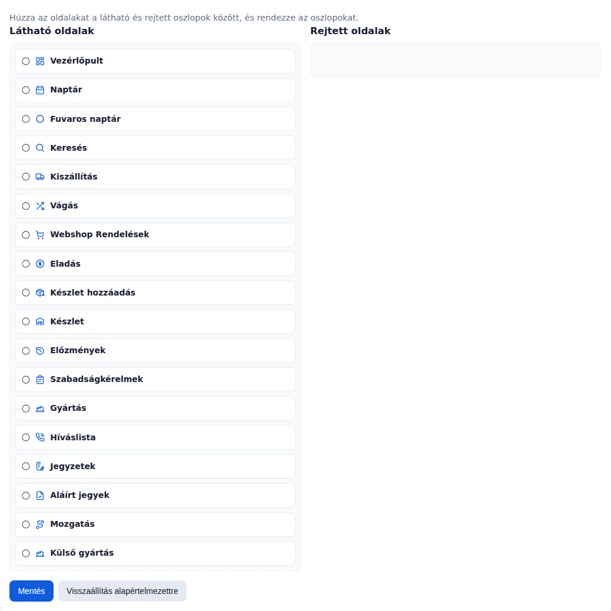
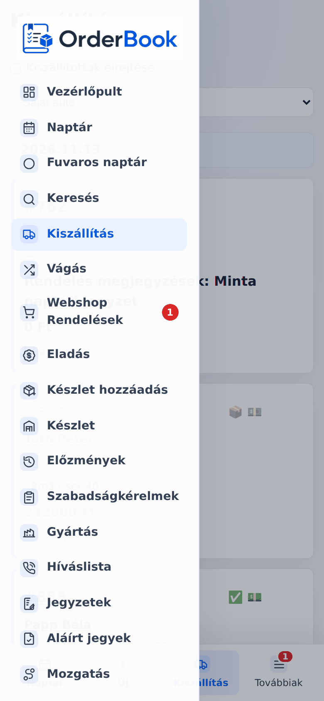

# Menü testreszabása

A menüben a felhasználónevedre kattintva érhető el a **Fiók beállítások** oldal. Itt a menüt lehet a saját munkádhoz igazítani.

- **Oldalsáv navigáció**: melyik oldal látszódjon a bal oldali menüben, és milyen sorrendben.
  Amit elrejtesz, az a **Rejtett oldalak** csoportba kerül, de továbbra is elérhető.
- **Mobil navigáció**: mely oldalak legyenek a telefon alsó menüsorában.
- **Visszaállítás alapértelmezettre**: visszaállítja az eredeti menüt.

Csak azok az oldalak választhatók, amelyekhez jogosultságod van.

Belépéssel és fiókkal kapcsolatos kérdésekben az admin segít; ez a kézikönyv nem foglalkozik velük.
