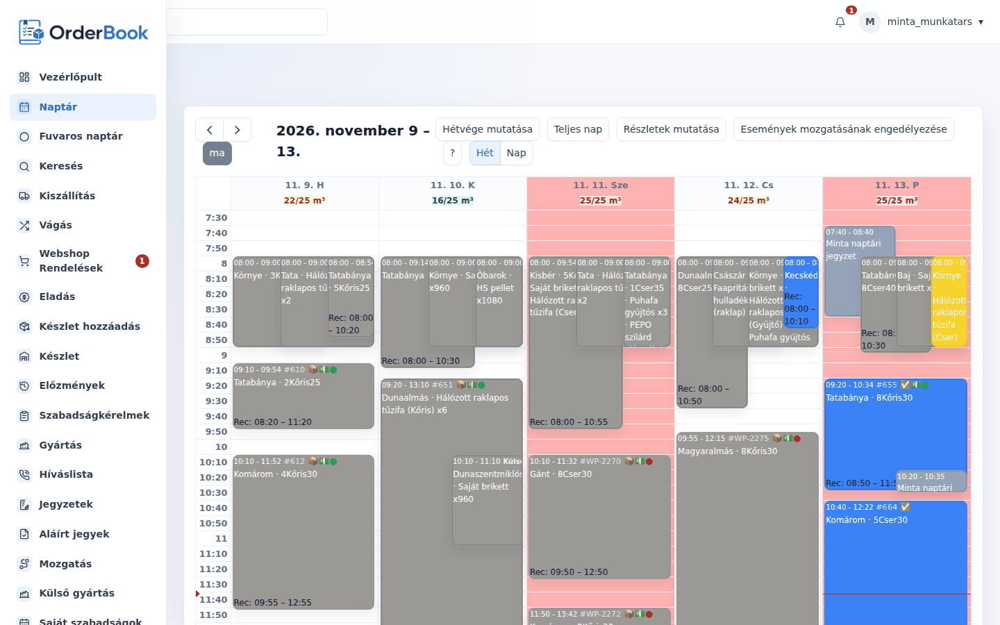
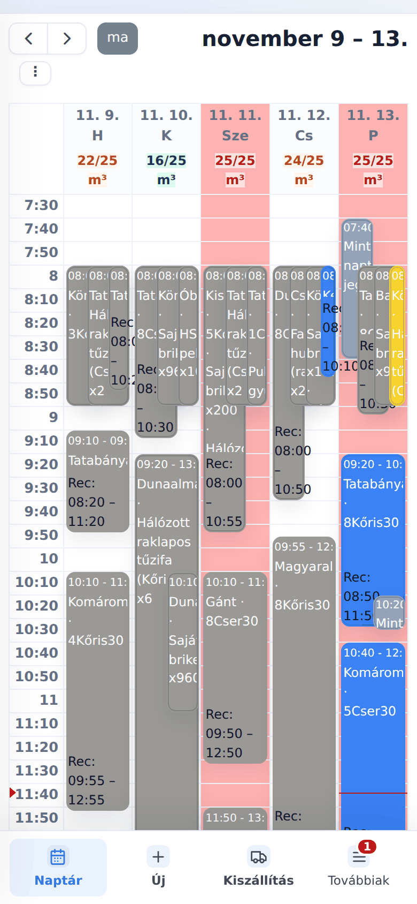
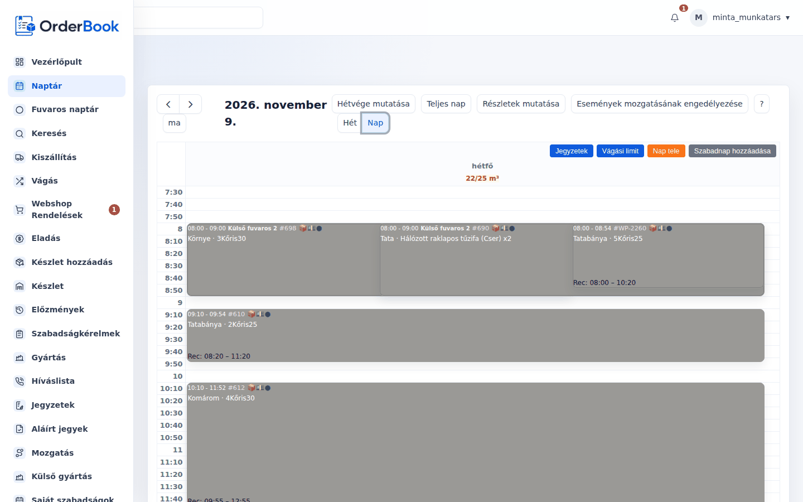

# Naptár

A **Naptár** oldal az összes rendelést és jegyzetet mutatja időpont szerint. Ez a fő munkafelület a rendelések felvételéhez.

## Nézetek és kezelés

- Nézetek: **Hét**, **3 nap**, **2 nap**, **Nap**. Előre/hátra nyilakkal lapozhatsz, a **Ma** gomb visszaugrik a mai napra.
- **Hétvége mutatása / Hétvége elrejtése** – a szombat és vasárnap megjelenítése.
- **Beállított órák / Teljes nap** – csak a munkaidő látszik, vagy a teljes 0–24 óra.
- **Részletek mutatása / Részletek elrejtése** – bekapcsolva a rendeléseken megjelenik az ügyfél neve, a rendelés és a
  vágói megjegyzés, valamint az ügyfél megjegyzései.
- **Események mozgatásának engedélyezése / tiltása** – alapból **tiltva** van, hogy véletlenül ne húzz el egy rendelést.
  Bekapcsolva a rendelések egérrel (telefonon nyomva tartással) áthúzhatók másik időpontra.
- **?** – jelmagyarázat.
- Tableten és telefonon ezek a gombok a **⋯** (**Naptár beállítások**) menüben vannak.

Ezeket a beállításokat a böngésző megjegyzi, de csak az adott eszközön.

## Mit mutat egy rendelés a naptárban

- A színe a fuvarost jelzi. A kiszállított rendelések külön színt kapnak (alapból zöldet), a jegyzetek szürkék.
- Állapotjelek (🪓 ✅ 📦), ‼️ problémás ügyfél, 💵 fizetve, a számla típusát jelző pötty (lásd [01-attekintes.md](01-attekintes.md)).
- A város és a termékek, a nem alapértelmezett fuvaros neve, az ügyfél időpont-kérése (**{idő} után**, **{idő} előtt**,
  **Első kiszállítás**) és alul az **ajánlott idősáv**.

## Napfejlécek

Minden nap fejlécén látszik:
- a napi **tűzifa-összeg / vágási limit** jelvény: zöld, ha van még hely; narancs, ha 8 m3-en belül van a limithez;
  piros, ha elérte vagy túllépte,
- 🏖 ha valaki szabadságon van, 📋 ha van napi jegyzet,
- a nap színe: **Nap tele** esetén narancssárga, betelt vágási limitnél külön szín, hétvégén szürkés.

## Új rendelés felvétele a naptárból

1. Kattints (koppints) a naptárban a kívánt nap és időpont üres helyére.
2. Megnyílik az **Új rendelés** űrlap, a kezdési idő előre kitöltve.
   - Ha a kattintás közel van egy előző rendelés végéhez (alapból 60 percen belül), a rendszer a kezdést
     automatikusan az előző rendelés vége + 15 perc időpontra igazítja, hogy ne fedjék egymást.
3. Töltsd ki a rendelést: [11-rendeles-felvetele.md](11-rendeles-felvetele.md).

Rendelést a menü **Új** gombjával is felvehetsz, ilyenkor az időpontot az űrlap **Ütemezés** részében kell megadni.

## Meglévő rendelés megnyitása

- Rendelésre kattintva a **rendelés megtekintése** oldal nyílik meg (lásd [12-rendeles-megtekintese-es-torlese.md](12-rendeles-megtekintese-es-torlese.md)).
- Jegyzetre kattintva rögtön a szerkesztő nyílik meg.

## Rendelés áthelyezése

1. Kapcsold be: **Események mozgatásának engedélyezése**.
2. Húzd a rendelést az új helyre, vagy a széle húzásával változtasd a hosszát.
3. A rendszer azonnal menti.
4. Utána kapcsold vissza a mozgatást tiltottra.

Az áthelyezés nem küld e-mailt az ügyfélnek. Ha az ügyfél már kapott visszaigazolást, és új időpontot kell neki
küldeni, nyisd meg a rendelést, és használd a **Rendelés-visszaigazolás újraküldése** lehetőséget (lásd [27-emailek.md](27-emailek.md)).

## Napi műveletek (Nap nézet)

**Nap** nézetben a nap tetején négy gomb van:

| Gomb | Mit csinál | Szükséges jog |
|------|-----------|---------------|
| **Jegyzetek** | Napi jegyzet hozzáadása a naphoz (📋) | **Jegyzetek (admin)** a mentéshez |
| **Vágási limit** | Az adott napra eltérő maximális vágási mennyiség. Üresen mentve visszaáll az általános limitre. | Naptár |
| **Nap tele** | A nap megjelölése beteltnek. A szabad időpont kereső kihagyja. | Naptár |
| **Szabadnap hozzáadása** | Egy dolgozó szabadnapjának felvétele (🏖) | Naptár |

## Jegyzet felvétele a naptárba (nem rendelés)

Ha egy időpontot le akarsz foglalni rendelés nélkül (pl. szerviz, saját fuvar):
1. Kattints az időpontra a naptárban.
2. Az űrlapon: **Váltás jegyzetre**.
3. Írd be a **Jegyzet szövege** mezőt, ellenőrizd a **Kezdés** és **Befejezés** időpontot
   (alapból a kattintás ideje + 1 óra).
4. **Jegyzet mentése**.

A jegyzet szürkén jelenik meg, nem foglal szállítási időt, és nem számít bele a vágási limitbe.
Meglévő rendelést nem lehet jegyzetté alakítani, és jegyzetet sem rendeléssé; ilyenkor újat kell felvenni.
