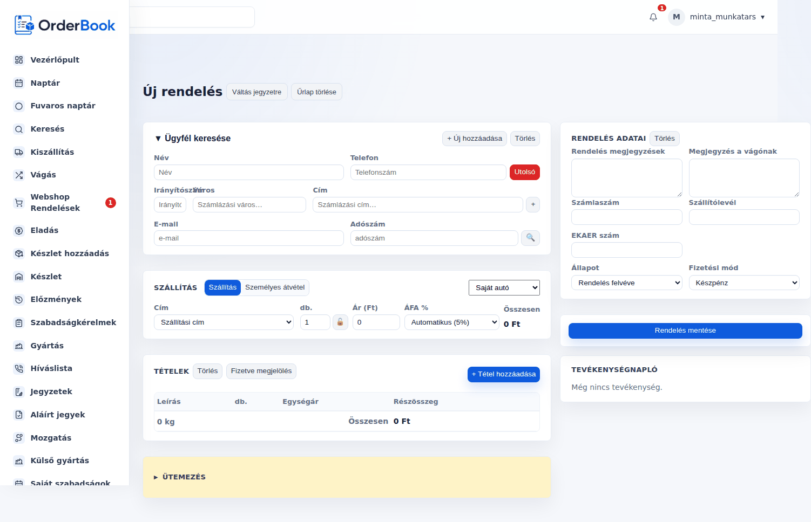
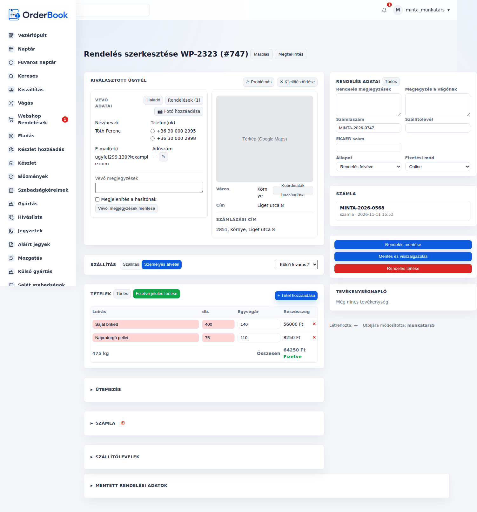
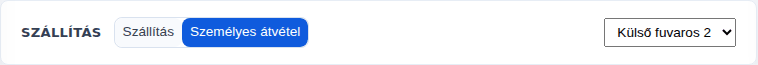
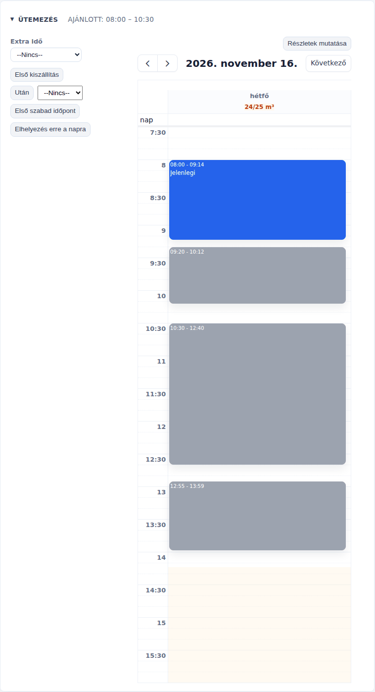

# Rendelés felvétele és szerkesztése

Az **Új rendelés** / **Rendelés szerkesztése** űrlap részei: ügyfél, **Szállítás**, **Tételek**, **Ütemezés**,
**Rendelés adatai**, valamint meglévő rendelésnél **Számla** és **Szállítólevelek**.
Számítógépen két oszlopban, telefonon egymás alatt jelennek meg.

## 1. Ügyfél kiválasztása

Az **Ügyfél keresése** blokkban bármelyik mezőbe írhatsz: **Név**, **Telefonszám**, **E-mail**, **Adószám**,
számlázási és szállítási **Város** / **Cím**. A találatok gépelés közben jelennek meg, a legjobb 5 ügyféllel.

- **Utolsó** gomb a telefon mezőnél: beírja az utoljára beérkezett hívás számát (ha a céges telefon továbbítja a hívásokat).
  A gomb színe jelzi, mennyire friss: alapszín 1 percen belül, narancs 1–5 perc, piros 5 percnél régebbi.
- **Adószám**: a 🔍 gombbal lekérdezhető a NAV-tól a cég neve és címe, a **Kitöltés** gomb beírja az adatokat.
- **Kiválasztás**: a találatra kattintva az ügyfél a rendeléshez kapcsolódik.
- **+ Új hozzáadása**: ha nincs találat, a beírt adatokból új ügyfél jön létre. Név, telefon és számlázási cím kell hozzá.
  Ha nincs külön szállítási cím, a számlázási cím lesz a szállítási is. Külön címet a
  **Külön szállítási cím megadása** gombbal adhatsz meg.
- **Törlés**: kiüríti a keresőmezőket.
- Utcanév írásakor a rendszer utcaneveket javasol a kiválasztott városban (legalább 3 betű után, házszám nélkül).

### A kiválasztott ügyfél paneljén
- Ha az ügyfélnek több neve, telefonja vagy e-mailje van, kiválaszthatod, melyik vonatkozzon erre a rendelésre.
- **Haladó**: név, telefon, e-mail hozzáadása vagy javítása.
- **Problémás / Nem problémás**: az ügyfél megjelölése (‼️). Mindenhol figyelmeztetés jelenik meg róla.
- **Vevő megjegyzések**: új megjegyzés írása. Ha bejelölöd a **Megjelenítés a hasítónak** opciót, a vágók is látják.
- **Szállítási cím térképe**: Google Maps előnézet. Itt adhatók meg az ügyfél **Koordinátái** is
  (**Utolsó GPS kitöltése** a sofőr telefonjának legutóbbi helyzetével).
- **Fotók**, **Rendelések**: az ügyfél fotói és korábbi rendelései.
- **Kijelölés törlése**: leválasztja az ügyfelet a rendelésről.

Ha ügyfél nélkül mented a rendelést (saját szállításnál), a rendszer rákérdez: **Ügyfél hozzáadása és mentés**,
**Mentés ügyfél hozzáadása nélkül** vagy **Vissza**. Ügyfél nélküli rendelés menthető, de számlázni nem lehet.

## 2. Szállítás

- **Szállítás / Személyes átvétel** kapcsoló (lásd [01-attekintes.md](01-attekintes.md)).
- **Fuvaros** választó. Külső fuvarosnál a rendszer automatikusan **Személyes átvétel**-re vált.
- Cím: **Szállítási cím** (az ügyfél szokásos címe), **Számlázási cím** vagy **Egyéb** (eltérő város és cím erre a rendelésre).
  A választott cím városa határozza meg a szállítási díjat és a szállítási időt.
- **db.** – szállítások (fordulók) száma. A rendszer a tételek súlyából és az autó kapacitásából automatikusan számolja.
  A lakat ikonnal (**Automatikus számítás zárolása**) kézzel rögzítheted.
- **Ár (Ft)** – a város szállítási díja. Átírható; ha több mint 15%-kal eltér a szokásostól, figyelmeztet, de engedi.
- **ÁFA %** – **Automatikus**, 5% vagy 27%. Az automatikus érték az admin beállításától függ.
- Ha egy kedvezmény a szállításra vonatkozik (pl. adott mennyiség felett ingyenes), az áthúzott ár mellett látszik.

## 3. Tételek

1. **Tétel hozzáadása** → válaszd ki a terméket és a változatot (lehet keresni: **Termékek keresése...**).
2. Add meg a mennyiséget. Szorzás is írható: `4*960`, `4x960` vagy `4×960`, ilyenkor a rendszer kiszámolja.
3. Az **Egységár** a katalógusárból töltődik. Átírható; 15%-nál nagyobb eltérésnél figyelmeztet, de engedi.
4. A kedvezményeket (mennyiségi kedvezmény, akciós ár) a rendszer automatikusan számolja és mutatja.
   Ha kézzel átírod egy tétel árát, arra a tételre az akciós ár nem íródik vissza.
5. **Összesen** – a végösszeg kedvezményekkel és szállítással együtt.
6. **Fizetve megjelölés** – ha az ügyfél már kifizette. Ekkor az összeg áthúzva, zölden „Fizetve” látszik, a naptárban 💵.
   Banki átutalásnál a számlázó rendszer visszajelzése alapján a rendszer automatikusan is jelölheti a fizetést.

A tétel sorának háttérszíne jelzi a készletet: narancs, ha ezzel a rendeléssel a várható készlet a figyelmeztetési
szint alá esik, piros, ha nem lenne elég. Ez csak figyelmeztetés, a rendelés így is felvehető.

## 4. Ütemezés (időpont)

Az **Ütemezés** blokk összecsukva is mutatja a választott időpontot és az ajánlott idősávot.
Amíg nincs elmentett időpont, a blokk kiemelt (sárgás) színű.

- **Extra idő** – plusz perc a rendelés hosszához (pl. nehezen megközelíthető hely).
- **Első kiszállítás** – a nap első kiszállítása (fix reggeli indulás).
- **Előtt / Után** + időpont – az ügyfél kérése, pl. „14:00 után” vagy „10:00 előtt”.
- **Első szabad időpont** – megkeresi a legközelebbi szabad helyet a következő 90 napban, a kérés figyelembevételével.
  Kihagyja a hétvégét, a **Nap tele** napokat és azokat a napokat, ahol a tűzifa nem férne bele a vágási limitbe.
  Saját szállításnál a rendelések között hagy egy minimális szünetet (alapból 15 perc).
  Személyes átvételnél és külső fuvarosnál csak a vágási kapacitást nézi.
- A kis naptárban: kék = ez a rendelés, szürke = más rendelések, zöld = **Javasolt** időpont, halvány narancs = szabad sáv.
  A javasolt időpont áthúzható. **Elhelyezés erre a napra**: az éppen nézett napra tesz egy javaslatot.
  A **Következő** gomb a kis naptár fejlécében a következő lehetőséget keresi.
- **Időpont elfogadása** – a javaslatot beírja a rendelésbe (még nem ment!).
- **Részletek mutatása** – a kis naptárban más rendelések városa és tételei is látszanak.

### Hogyan számol a rendszer
- **Időtartam** saját szállításnál: oda-vissza út × fordulók száma + fordulónkénti rakodási idő + súlytól függő plusz idő + extra idő.
  Személyes átvételnél és város nélküli rendelésnél fix (alapból 1 óra) + extra idő.
- **Ajánlott idősáv**: az indulás + a fél útidő (érkezés) körül egy beállított sáv, kerekítve.
  Ha az ügyfél kért időpontot (előtt/után), a sáv ehhez igazodik. Személyes átvételnél nincs ajánlott idősáv.

Ha javaslatot hagysz elfogadatlanul, és el akarsz menni vagy menteni akarsz, a rendszer rákérdez
(**El nem fogadott ajánlás**): **Elfogadás és mentés**, **Eldobás és mentés**, **Maradás** stb.

## 5. Rendelés adatai

- **Rendelés megjegyzések** – belső megjegyzés.
- **Megjegyzés a vágónak** – a vágók és a fuvarosok is látják.
- **Számlaszám**, **Szállítólevél** (kézi szállítólevélszám), **EKAER szám**.
- **Állapot** – **Rendelés felvéve**, **Vágás alatt**, **Szállításra kész**, **Kiszállítva**. Az állapot kézi
  átállítása ugyanúgy mozgatja a készletet, mint a Vágás és a Kiszállítás oldal (lásd [01-attekintes.md](01-attekintes.md)).
- **Fizetési mód** – pl. készpénz, átutalás. Webshop rendelésnél a webshopból jön.

## 6. Mentés

- **Rendelés mentése** – menti a rendelést. Új rendelésnél utána a szerkesztő oldal marad nyitva.
- **Mentés és visszaigazolás** – ment, és elküldi az ügyfélnek a **visszaigazoló e-mailt**, majd a rendelést
  visszaigazoltnak jelöli. Ezután a rendszer az időpont előtt (alapból 2 nappal) **emlékeztető e-mailt** is küld.
  Ehhez e-mail cím kell. Lásd [27-emailek.md](27-emailek.md).
- Ha nem mentett módosítással akarsz kilépni: **Mentés és kilépés**, **Kilépés mentés nélkül** vagy **Maradás**.
- Új rendelés közben a böngésző 15 percig piszkozatot tart: ha véletlenül bezárod, újranyitva visszatölti.

Mentéskor a rendszer újraszámolja a kedvezményeket, az időtartamot és a szállítást, és naplózza a változást
(**Tevékenységnapló** az oldal alján: ki, mikor, mit módosított).

### Mentett rendelési adatok (meglévő rendelésnél)
Az oldal alján, a **Mentett rendelési adatok** részben:
- **Rendelés-visszaigazolás újraküldése**,
- **Emlékeztető küldése** (azonnal),
- **Emlékeztető tiltása** (erre a rendelésre nem megy automatikus emlékeztető),
- **Értékelő e-mail küldése** és az értékelés kérés állapota,
- webshop rendelésnél: **Áreltérési értesítés letiltása**.

Az e-mailek a **mentett** adatokkal mennek ki, ezért előbb ments.

## Másolás és beillesztés

- **Másolás** – egy rendelés adatait (ügyfél, tételek) vágólapra teszi 5 percre.
- **Beillesztés** – csak új rendelésnél: átveszi az ügyfelet és a tételeket a mai árakkal.
  Számlaszám, szállítólevélszám és állapot nem másolódik.
- **Űrlap törlése** – kiüríti az új rendelés űrlapját.

## Gyakori kérdések
- **Mi számít a szállítási díjba?** A választott cím városának díja × fordulók száma, a szállítási kedvezmények levonásával.
- **Miért váltott át Személyes átvételre?** Külső fuvarost választottál.
- **Miért nincs ajánlott idősáv?** Személyes átvétel, vagy nincs város, vagy az ügyfél kérésével nincs átfedés.
- **Mentés sikertelen — hálózati hiba.** Az adat nem mentődött. Ellenőrizd a kapcsolatot, és mentsd újra; az űrlap tartalma megmarad.
