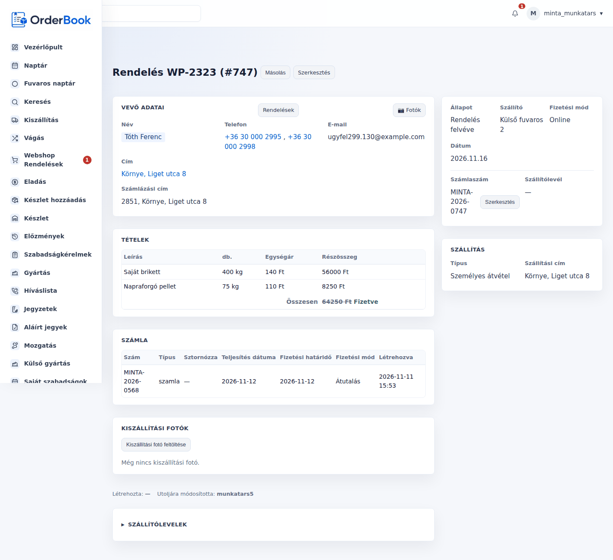

# Rendelés megtekintése és törlése

## Rendelés megtekintése

A naptárban egy rendelésre kattintva a **Rendelés** megtekintő oldal nyílik meg. Ez csak olvasható összefoglaló:

- ügyfél, kiválasztott név/telefon/e-mail, szállítási és számlázási cím, a telefonszám hívható link,
- tételek, kedvezmények, szállítás, végösszeg, fizetési állapot (**Fizetve**, részben fizetve, túlfizetés),
- időpont, **ajánlott idősáv**, az ügyfél időpont-kérése,
- **Rendelés megjegyzések**, **Megjegyzés a vágónak**, vevő megjegyzések,
- számlák PDF-fel, szállítólevelek (**Szállítólevél-sorszámok**), fájlok és fotók,
- **Készletmozgások**: milyen készletmozgást okozott a rendelés (ki, mikor, mit),
- **Változási előzmények**: ki és mikor mit módosított.

A szerkesztéshez a **Szerkesztés** gombot használd (**Rendelések** jog kell).
Webshop rendelésnél a fejlécben a webshop rendelésszáma és zárójelben a belső azonosító látszik.

## Rendelés törlése

1. Nyisd meg a rendelést (megtekintő vagy szerkesztő oldal), vagy a naptárban a rendelés törlés gombját.
2. **Rendelés törlése** → erősítsd meg (**Biztosan törölni kívánja ezt a rendelést?**).

Mi történik:
- A rendelés a **kukába** kerül: eltűnik a naptárból, a keresésből, a Kiszállítás és a Vágás oldalról, és a készlet-előrejelzésből.
- A rendelés által okozott **készletmozgások törlődnek** (pl. ha már készre volt jelölve, a tűzifa-hozzáadás és az
  alapanyag-levonás visszavonódik).
- A törlés naplózódik (ki törölte).

Mikor **nem** lehet törölni:
- ha a rendeléshez **aktív szállítólevél** tartozik, vagy a szállítólevél állapota nem ellenőrizhető. Ilyenkor előbb a
  szállítólevelet kell érvényteleníteni (lásd [18-szallitolevelek.md](18-szallitolevelek.md)). A törlés nem érvényteleníti
  automatikusan a szállítólevelet.

## Visszaállítás a kukából

Munkatárs nem tud visszaállítani. Szólj az **adminnak**, ő a kukából visszaállíthatja a rendelést. Visszaállításkor
a rendszer az állapotnak megfelelő készletmozgásokat újra létrehozza.
A kukában lévő rendelések alapból **2 nap** után automatikusan, véglegesen törlődnek. Ha tévedésből töröltél,
ezért mielőbb szólj.

## Kiállított számla és törlés

A törlés **nem sztornózza** a számlát. Ha a rendeléshez számla készült, és a rendelés tényleg elmarad, előbb
sztornózd a számlát (lásd [17-szamlazas.md](17-szamlazas.md)), utána töröld a rendelést.
