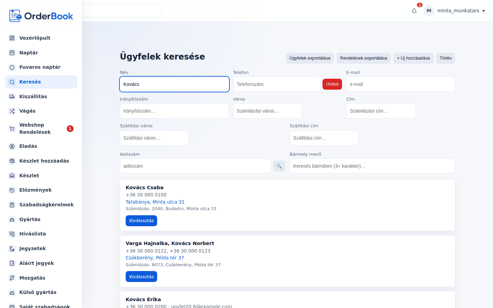
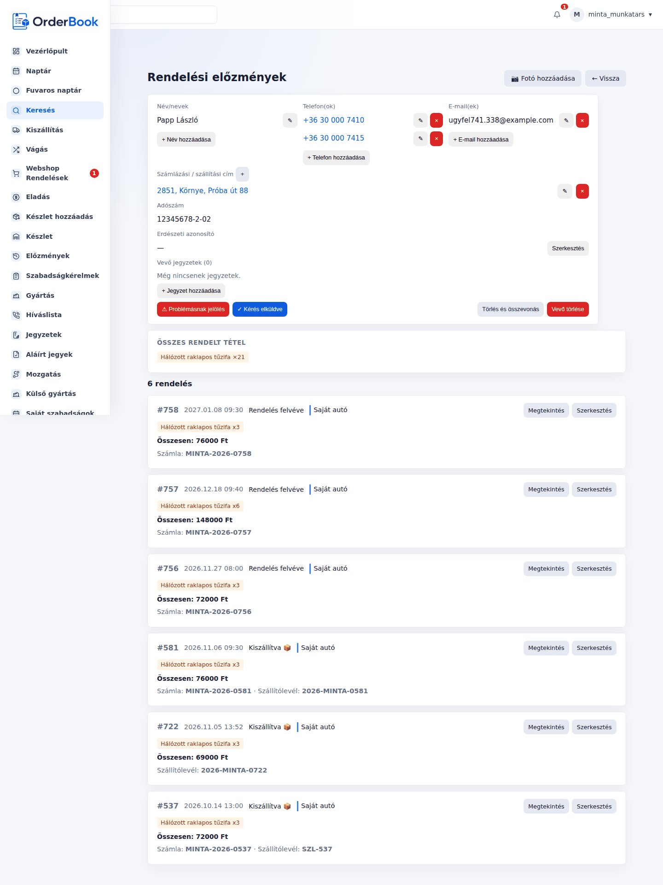
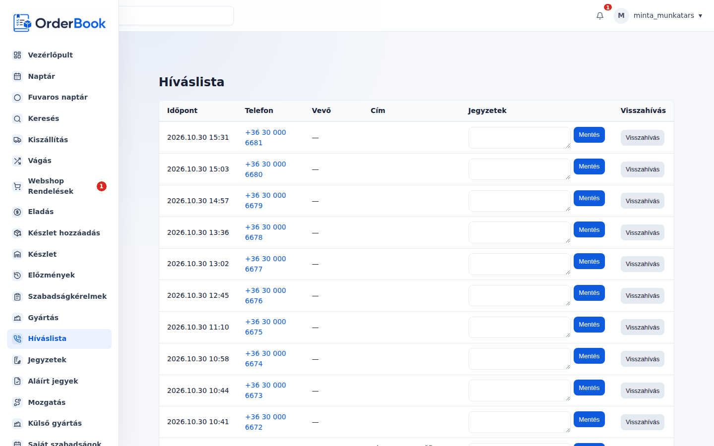

# Ügyfelek és keresés

## Keresés oldal (Ügyfelek keresése)

Menü → **Keresés**. A kereséshez a **Rendelések** jog is kell.

Mezők: **Név**, **Telefon**, **E-mail**, **Város**, **Cím**, számlázási adatok, **Adószám**, **Bármely mező**.
A rendszer gépelés közben a legjobb 5 ügyfelet mutatja.

Hogyan keres:
- A név és a cím **elírást is tűr** (pl. ékezet nélkül, egy-két betű hibával).
- A telefon, e-mail és adószám részleges egyezést keres.
- Ha **várost** adsz meg, az kötelező szűrő: csak az adott városban lakó ügyfelek jönnek, a város önmagában nem ad találatot.
- Minél több mező egyezik, annál előrébb kerül az ügyfél.
- **Bármely mező** (legalább 3 karakter): az ügyfél minden adatában és a rendeléseiben is keres (pl. számlaszám,
  webshop rendelésszám, szállítólevélszám, megjegyzés, terméknév). Csak számjegyeket beírva a telefonszámokban is keres.
- **Utolsó**: beírja az utoljára beérkezett hívás telefonszámát, és rákeres.
- **Adószám** + 🔍: NAV lekérdezés, a **Kitöltés** beírja a cég nevét és címét.

Gombok:
- **+ Új hozzáadása** – új ügyfél a beírt adatokból (név, telefon, számlázási cím kötelező). Ha nincs szállítási cím,
  a számlázási cím lesz az.
- **Törlés** – kiüríti a mezőket.
- **Ügyfelek exportálása**, **Rendelések exportálása** – letöltés CSV vagy Excel (XLSX) formátumban.
  A rendelésexportnál dátumtartomány adható meg.

Az ügyfélnevek mentéskor automatikusan nagy kezdőbetűt kapnak (pl. „kiss péter” → „Kiss Péter”).

## Ügyféloldal (Rendelési előzmények)

A találatra kattintva nyílik meg. Itt látszik és szerkeszthető:
- nevek, telefonok, e-mailek (több is lehet), **Adószám**,
- szállítási és számlázási cím. Ha a kettő megegyezik, egy közös cím látszik; a **+** gombbal adható meg külön szállítási cím,
- **Erdészeti azonosító** (vevői azonosító a szállítólevélhez, max. 10 karakter) – csak itt szerkeszthető,
- **Vevő megjegyzések** időrendben (a **Hasítónak** jelölésűt a vágók is látják),
- **Problémás ügyfél** jelölés,
- értékelés kérés állapota (**Kérés elérhető** / **✓ Kérés elküldve**) – **Értékelő e-mail** jog kell,
- az ügyfél összes rendelése és eladása, **Összes rendelt tétel**.

Ha egy ügyfél e-mail címét javítod, a rendszer a jövőbeli, még ki nem szállított rendelésein is frissíti, ahol a régi cím volt kiválasztva.
Ha a szállítási címet módosítod, az ügyfél mentett GPS koordinátája törlődik, mert az a régi címre vonatkozott.

### Ügyfél törlése és összevonása
- **Vevő törlése**: az ügyfél törlődik, a rendelései megmaradnak, de ügyfél nélkül.
- **Ügyfelek összevonása** (**Törlés és összevonás**): ha ugyanaz az ügyfél kétszer szerepel, a duplikátum oldalán
  válaszd ki, melyik ügyfél tartsa meg a rendeléseket. A rendelések átkerülnek hozzá, a duplikátum törlődik. Ez nem vonható vissza, ezért előtte ellenőrizd az adatokat.

## Ügyfélfotók

Az ügyfélhez fotók tölthetők fel (pl. hová kell lerakni a fát). A **Fotók** linkkel nyílnak meg. Megtekintéshez a
**Vevőfotók (megtekintés)**, feltöltéshez és törléshez a külön feltöltési/törlési jog kell. A vágók a Vágás oldalon is látják.

## Híváslista

Menü → **Híváslista**. A céges telefonra beérkezett hívások listája, a legújabb elöl. Ha a szám egy ismert ügyfélé,
mellette látszik a neve és a címe. A számra kattintva a Keresés oldal nyílik meg a számmal kitöltve.
A **Visszahívás** gombbal megjelölheted, hogy a hívót vissza kell hívni (a sor kiemelt lesz). Ha megvolt, a gomb
(**Visszahívva ✓**) újabb megnyomásával a jelölés törölhető.
