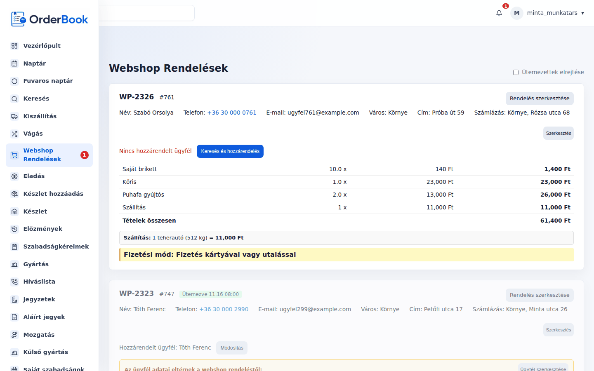

# Webshop rendelések

A webshopban leadott rendelések automatikusan megjelennek a rendszerben, **időpont nélkül**.
A menüben a **Webshop Rendelések** mellett egy szám mutatja, hány rendelés vár feldolgozásra.

## Mi történik, amikor beérkezik egy webshop rendelés

- Létrejön egy rendelés a webshop rendelésszámmal, tételekkel, szállítással, fizetési móddal és az ügyfél megjegyzésével.
- Az ügyfél **„Rendelés beérkezett”** e-mailt kaphat (ha be van állítva).
- A rendelés **még nincs a naptárban** és **még nincs ügyfélhez kapcsolva**. Ezt nekünk kell elvégezni.
- Ha a webshop új fizetési módot küld, a rendszer automatikusan felveszi; az admin később rendbe teszi.

## Feldolgozás lépései

1. Menü → **Webshop Rendelések**.
2. Nézd át a kártyát: név, telefon, e-mail, szállítási és számlázási adatok, tételek, a webshop megjegyzés és fizetési mód
   (kiemelt dobozban).
3. **Ügyfél hozzárendelése**:
   - **Keresés és hozzárendelés** → a rendszer megkeresi a hasonló ügyfeleket (telefon, e-mail, név – akkor is, ha a
     vezeték- és keresztnév fel van cserélve –, város, cím alapján), pontszám szerint rendezve.
   - Ha megvan: **Hozzárendelés**.
   - Ha nincs: **+ Új ügyfél hozzáadása** – a webshop adataiból új ügyfél jön létre.
   - Ha a hozzárendelt ügyfél adatai eltérnek a webshop adataitól (**Az ügyfél adatai eltérnek a webshop rendeléstől**),
     egy táblázat mutatja a különbséget. Az új adat (pl. új telefonszám) hozzáfűzhető az ügyfélhez.
   - A webshop adatai (pl. elírt cím) a kártyán javíthatók.
4. **Árak ellenőrzése**: a rendszer összeveti a webshop árait a saját számításával.
   - **Végösszeg eltérés** / **Webshop szállítás: … Ft (eltérés!)** – a webshop más összeget számolt, mint a rendszer
     (pl. elavult ár vagy hiányzó kedvezmény). Döntsd el, melyik a helyes, és szükség esetén javítsd a rendelésben.
   - **WP: ingyenes szállítás** – a webshop ingyenes szállítást adott (pl. akció), a rendszer szerint viszont lenne díj.
   - **nincs párosítva** – a webshop tétele nem talált párt a termékkatalógusban; a rendelésben kézzel kell kiválasztani a terméket.
5. **Ütemezés**: **Rendelés szerkesztése** → a rendelés űrlapján az **Ütemezés** részben válassz időpontot
   (lásd [11-rendeles-felvetele.md](11-rendeles-felvetele.md)) → mentés. Ezzel kerül a naptárba.
   Ha az ügyfél visszaigazolást kap, használd a **Mentés és visszaigazolás** gombot.
6. Az ütemezett rendelés kártyáján **Ütemezve** felirat jelenik meg. Az **Ütemezettek elrejtése** jelölővel eltüntetheted
   a kész rendeléseket a listából.

## Kiszállítás után

Ha be van kapcsolva, a **Kiszállítva** jelölés után a rendszer a webshopban is **teljesítettre** állítja a rendelést.
Ha ez nem sikerül (pl. a webshop nem érhető el), a helyi kiszállítás akkor is érvényes; az admin a naplóban látja a hibát.

## Áreltérési értesítés

Ha egy webshop rendelés ára eltér, a rendszer értesítést küldhet. Ezt rendelésenként le lehet tiltani:
rendelés szerkesztése → **Mentett rendelési adatok** → **Áreltérési értesítés letiltása**.
