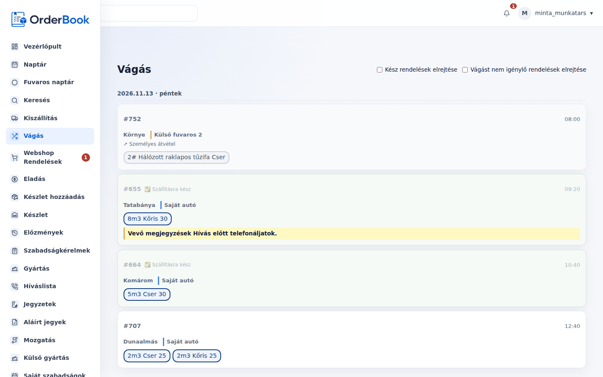
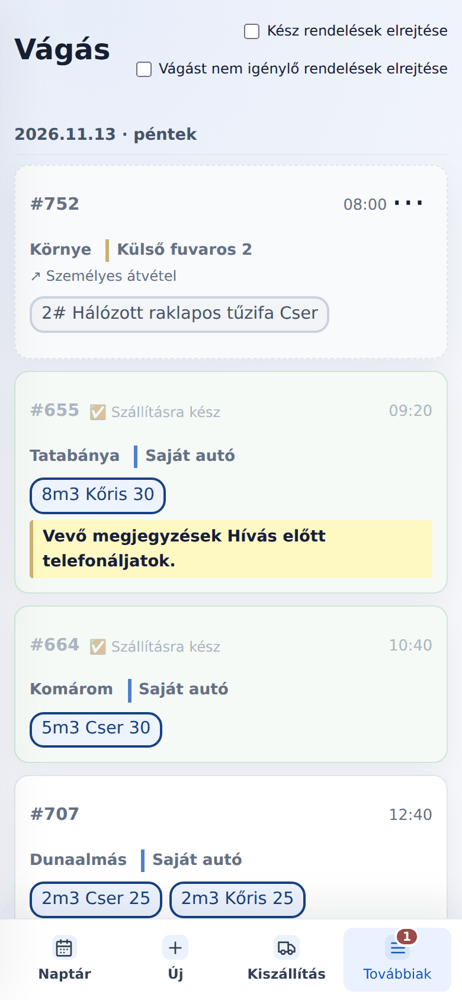

# Vágás oldal

Menü → **Vágás**. A vágócsapat munkalistája: **Közelgő kiszállítások és elvitelek. Kezdjétek el a munkát, majd jelöljétek késznek.**
Jogosultság: **Hasítandó**.

## Mely rendelések jelennek meg

- Az ütemezett (naptárban lévő), nem törölt rendelések **Rendelés felvéve**, **Vágás alatt** és **Szállításra kész** állapotban,
  mai és jövőbeli dátummal, időrendben. A saját szállítások, az elvitelek és a külső fuvarosok rendelései is.
- Alapból a következő **20** rendelés látszik; a lap alján a **További rendelések betöltése** gombbal bővíthető.
- A **Vágás alatt** állapotú rendelések a dátumtól függetlenül mindig látszanak, hogy ne vesszen el félbehagyott munka.
- Az ütemezetlen webshop rendelések nem jelennek meg; előbb időpontot kell nekik adni.
- Szűrők (a böngésző megjegyzi):
  - **Kész rendelések elrejtése** – a **Szállításra kész** rendelések elrejtése,
  - **Vágást nem igénylő rendelések elrejtése** – azok elrejtése, amelyekben nincs tűzifa.

## Mit mutat egy kártya

- Dátum fejléc a nap nevével, a rendelés időpontja.
- **Tételek** árak nélkül: a **tűzifa kék** címkével, m3-ben, a többi tétel szürke címkével.
- A város (utca nélkül) és a fuvaros, a fuvaros színével. Saját elvitelnél „Elvitel” felirat. **Nincs szállító megadva**, ha nincs fuvaros.
- **Megjegyzés a vágónak** és a **Hasítónak** jelölt vevő megjegyzések. A belső rendelésmegjegyzést és az árakat a vágók nem látják.
- Ügyfélfotók linkje, ha van fotó és jogosultság.
- **Vágás alatt** kártya: világos narancs háttér, és **Elkezdte:** (ki kezdte el).

A kártyára koppintva nyílnak meg a gombok. Egyszerre több kártya is nyitva lehet.

## Teendők

| Gomb | Mikor | Mi történik |
|------|-------|-------------|
| **Vágás megkezdése** | Elkezded vágni a rendelés tűzifáját | Állapot: **Vágás alatt**. A készlet nem változik. Csak tűzifás rendelésnél. |
| **Készre jelölés** | Kész a vágás / a rendelés szállítható | Állapot: **Szállításra kész**. A kész tűzifa **hozzáadódik** a készlethez, a felhasznált **alapanyag levonódik**. Külső fuvarosnál értesítő e-mail mehet a fuvarosnak. |
| **Vissza a közelgőkhöz** | Tévedésből kezdted el | Vissza **Rendelés felvéve** állapotba, készlethatás nélkül. |
| **Vissza: Rendelés felvéve** | Tévedésből jelölted késznek | Vissza **Rendelés felvéve** állapotba. A „kész” készletmozgás (tűzifa-hozzáadás, alapanyag-levonás) **visszavonódik**. |

- A **Készre jelölés** a **⋮** menüből vágás megkezdése nélkül is elérhető (pl. tűzifát nem igénylő rendelésnél).
- A munka közös: bárki befejezheti, amit más kezdett el, és egyszerre több rendelés is lehet **Vágás alatt**.
- Ha egy gombot kétszer nyomnak meg, vagy ketten egyszerre, a rendszer csak egyszer hajtja végre.

## Élő frissítés

Az oldal 10 másodpercenként frissül. Ha valaki módosít egy rendelést (pl. más időpont, más mennyiség), a kártya
frissül, és egy sáv jelzi az új vagy változott rendeléseket. Ha a kártya a gombnyomás pillanatában már elavult volt
(pl. időközben módosították a mennyiséget), a rendszer **nem** hajtja végre a műveletet, hanem megmutatja a friss
kártyát: nézd meg, és nyomd meg újra. Kapcsolat nélkül **A frissítés nem elérhető** jelzés és **Újrapróbálás** gomb jelenik meg.
