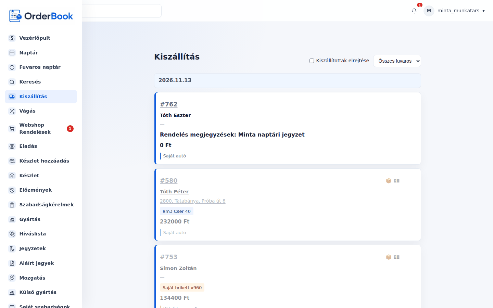
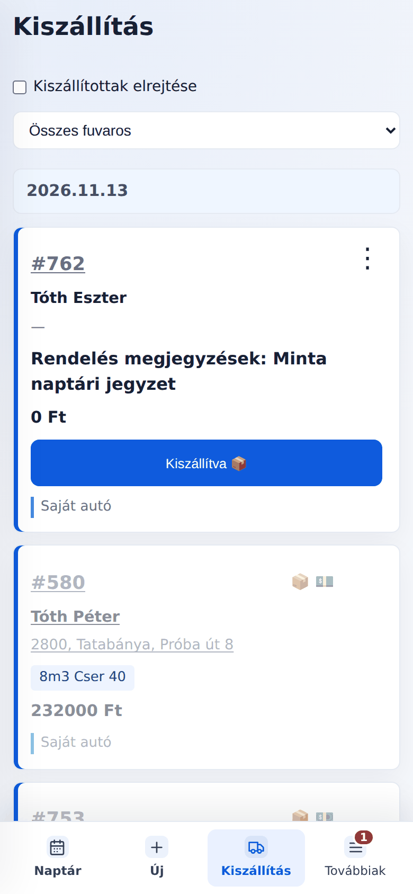

# Kiszállítás oldal

Menü → **Kiszállítás**. A sofőrök és a diszpécserek oldala: mit kell kivinni a következő napokban, és mi lett kiszállítva.
Jogosultság: **Kiszállítás**.

## Mit mutat

- A mai és a következő napok rendeléseit (alapból **3** nap a mai nappal együtt), időrendben, napok szerint csoportosítva.
- Alapból csak az **alapértelmezett fuvaros** (saját autó) rendeléseit. A fejléc legördülő menüjében választható másik fuvaros
  vagy **Összes fuvaros**.
- **Kiszállítottak elrejtése**: elrejti a már kiszállított (halványított) kártyákat. A böngésző megjegyzi.

Egy kártyán: rendelésszám, állapotjelek (🪓 ✅ 📦), ‼️, 💵 fizetve / 💸 részben fizetve, számlatípus pötty,
ügyfélnév (hívható, ha van telefonszám), cím (Google Maps linkkel), 📍 ha az ügyfélnek mentett GPS helye van,
az időpont-kérés (**Első kiszállítás**, előtt/után), tételek, végösszeg, megjegyzések.
Elvitelnél (személyes átvétel) nincs cím és térkép.

A térkép link a mentett GPS koordinátát használja, ha az ügyfél szokásos címére megy a rendelés; egyébként a címet.

## Kártya kinyitása

Koppints a kártyára → megjelennek a gombok és a **⋮** (**Műveletek**) menü. A rendelésszámra koppintva a rendelés
megtekintése nyílik meg (ha van hozzá jogod).

## Kiszállítottnak jelölés

1. Kártya kinyitása → **Kiszállítva 📦** → megerősítés (**Megjelöli ezt a rendelést kiszállítottként?**).
2. A rendszer:
   - **Kiszállítva** állapotba teszi a rendelést, a kártya elhalványul,
   - **levonja a kiszállított termékeket** a készletből. Ha a rendelést korábban nem jelölték készre, a „kész” lépést
     is elvégzi (tűzifa-hozzáadás, alapanyag-levonás), így a készlet helyes marad,
   - ha be van kapcsolva, a webshopban is lezárja a rendelést.
3. Ha van **Értékelő e-mail** jogod, és az ügyfél még nem kapott értékelés kérést, felugrik az **Értékelés kérés** ablak:
   - **Értékelő e-mail küldése** – elküldi az e-mailt, és megjelöli az ügyfelet,
   - **Értékeltnek jelölés** – csak megjelöli, e-mail nélkül (pl. szóban már kérted),
   - **Ne küldje** – most nem történik semmi.

Ha tévedésből jelölted kiszállítottnak: nyisd meg a rendelést szerkesztésre, és állítsd vissza az **Állapot** mezőt.
A készletlevonás visszavonódik.

## GPS hozzáadása

Ha a sofőr az ügyfélnél áll, és a telefonos alkalmazás az elmúlt **5 percben** küldött helyzetet, a kártyán megjelenik a
**GPS hozzáadása** gomb. Megnyomva a jelenlegi helyzet az ügyfél koordinátájaként mentődik, és legközelebb a térkép
pontosan oda navigál (📍). Csak akkor elérhető, ha a rendelés az ügyfél szokásos szállítási címére megy.

## Km óra rögzítése

**⋮** → **km óra rögzítése**: a jármű kilométeróra-állása egész km-ben. A szállítólevél készítésekor ez az érték
előre kitöltődik. Üresen mentve törlődik. A meglévő szállítóleveleket nem módosítja.

## Feltöltés (fotó, szállítólevél)

**⋮** → **Feltöltés** → válaszd ki a **Feltöltés típusá**t:
- **Kiszállítási fotó** – fotó a lerakott áruról (jogosultság kell). A saját feltöltésű fotó **10 percen belül** törölhető.
- **Vevőfotó** – fotó az ügyfélhez (pl. hová kell lerakni).
- **Szállítólevél** – az ügyfél által **aláírt szállítólevél** feltöltése. Csak akkor látszik, ha a rendeléshez már készült
  szállítólevél, és van **Rendelések** jogod. **Válasszon szállítólevelet**, majd a fotót vagy PDF-et.
  Lásd [18-szallitolevelek.md](18-szallitolevelek.md).

A fotókat a rendszer automatikusan tömöríti és elforgatja.

## Gyakori kérdések

- **Nem látom a rendelést.** Más fuvaroshoz tartozik (válts **Összes fuvaros**-ra), később van, mint a látható napok,
  vagy még nincs ütemezve (webshop rendelés).
- **Nincs GPS hozzáadása gomb.** Az alkalmazás nem küldött helyzetet az elmúlt 5 percben, nincs ügyfél a rendelésen,
  vagy a rendelés nem az ügyfél szokásos címére megy.
