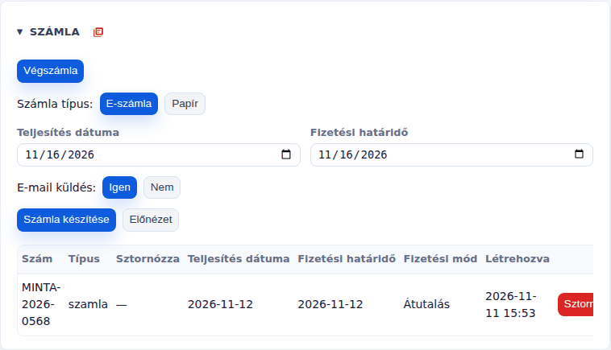

# Számlázás (rendeléseknél)

A számlák a **Számlázz.hu** rendszerben készülnek, a rendelésből automatikusan kitöltve. A PDF a rendeléshez mentődik.
Számlázni a **Rendelések** joggal lehet, megnézni a **Rendelések — csak megtekintés** joggal is.
A raktári eladások számlázása: [21-eladas.md](21-eladas.md).

> A kiállított számla **nem törölhető**, csak **sztornózható**. Kiállítás előtt mindig ellenőrizd az előnézetet.

## Hol van

Meglévő rendelés szerkesztése → **Számla** blokk (az **Ütemezés** alatt). Jegyzetnél és még el nem mentett új rendelésnél
nincs számla blokk. Ha a rendelésen nem mentett módosítás van, a számlakészítés nem indul el: **előbb mentsd a rendelést**,
mert a számla a mentett adatokból készül.

## Számla készítése lépésről lépésre

1. **Számla típus**:
   - **Előlegszámla** – előre fizetett összegről. Utána végszámla kell.
   - **Számla** – normál számla.
   - **Végszámla** – csak akkor jelenik meg, ha már van érvényes előlegszámla. Mindig **Átutalás** fizetési móddal készül,
     és automatikusan hivatkozik az előlegszámlára.
   - Alapértelmezés: **Szállításra kész** rendelésnél, ha még nincs számla, **Számla**, egyébként **Előlegszámla**.
2. **E-számla / Papír** – alapból e-számla, ha a rendeléshez van e-mail cím.
3. **Fizetési mód** – **Készpénz**, **Bankkártya**, **Átutalás** (számlánál és előlegszámlánál). Bankkártyánál a számla
   fizetettként jelölve készül.
4. **Teljesítés dátuma** és **Fizetési határidő**:
   - számlánál alapból a rendelés dátuma,
   - előlegszámlánál a teljesítés alapból ma, a határidő a rendelés előtti nap (de nem korábbi a mainál).
   - Ha egy normál számla teljesítése egy későbbi hónapra esik, piros figyelmeztetés jelenik meg.
5. **E-mail küldés: Igen / Nem** – elküldje-e a Számlázz.hu a számlát az ügyfélnek e-mailben.
6. **Előnézet** – megmutatja pontosan, mi menne a Számlázz.hu-ba: fejléc, vevő, tételek, ÁFA, bruttó összegek. Ez még nem állít ki semmit.
7. **Számla készítése** → megerősítés → a számla elkészül, megjelenik a listában **PDF megnyitása** linkkel.
   A rendelés **Számlaszám** mezője automatikusan kitöltődik.

### Mi kerül a számlára
- **Vevő**: az ügyfél neve, **számlázási** címe (ha nincs, a szállítási címe), irányítószáma és adószáma.
  Hiányzó irányítószámot a rendszer nem pótol: ha üres, javítsd az ügyféloldalon.
- **Tételek**: a termékek számlanéven, a kedvezményekkel csökkentett áron.
- **Szállítás**: „Házhozszállítás - {város}” néven. Személyes átvételnél és külső fuvarosnál nem kerül a számlára.
  A 0 Ft-os szállítás az admin beállításától függően kimaradhat.
- **Szállítás ÁFA**: a rendelésen kézzel választott 5% vagy 27%, vagy az automatikus szabály szerint.

### Készpénz → átutalás figyelmeztetés
Ha a rendelés fizetési módja készpénz (utánvét), de **Átutalás**os számlát készítesz, a rendszer rákérdez
(**Módosítod a rendelés fizetési módját?**):
- **Fizetési mód módosítása és számla létrehozása** – a rendelés fizetési módja is átállítódik (pl. banki átutalásra),
- **Készpénz megtartása és számla létrehozása** – a rendelés készpénzes marad,
- **Mégse**.

## Sztornó

1. A számla sorában **Sztornó**.
2. Válaszd: **E-mail küldése az ügyfélnek**, **Ne küldjön e-mailt** vagy **Mégse**.
3. Elkészül a sztornó számla, és a listában a **Sztornózza** oszlop mutatja, melyik számlát érvényteleníti.

- Sztornó számlát nem lehet újra sztornózni, és egy számlát csak egyszer lehet.
- Ha minden számla sztornózva van, újra **Előlegszámla** és **Számla** választható.
- Törölt (kukában lévő) rendelés számlája nem sztornózható; előbb az admin állítsa vissza a rendelést.

## Fizetés nyomon követése

- Átutalásnál a Számlázz.hu visszajelzése alapján a rendszer rögzíti a befizetett összeget. Ha a teljes összeg megjött,
  a rendelés **Fizetve** lesz; részfizetésnél „Részben fizetve” (💸) látszik.
- Kézzel a rendelés **Fizetve megjelölés** gombjával jelölhető.

## Nyomtatás
Ha van beállított nyomtató, a számla soránál **Direkt nyomtatás** gomb is van (lásd [28-nyomtatas.md](28-nyomtatas.md)).

## Gyakori hibák
- **Hiba a számla létrehozásakor.** A Számlázz.hu elutasította (pl. hiányzó vevőadat) vagy nem érhető el. Ellenőrizd a
  vevő nevét és számlázási címét, majd próbáld újra. Ha továbbra sem megy, szólj az adminnak.
- **Nincs Végszámla gomb.** Nincs érvényes (nem sztornózott) előlegszámla.
- **Nincs aktív nem készpénzes fizetési mód.** Az admin nem állított be átutalásos fizetési módot.
