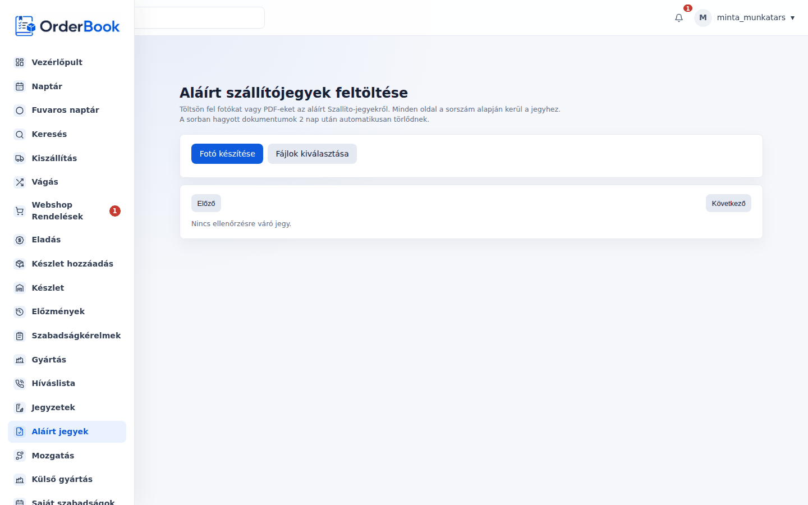

# Szállítólevelek (Szállító rendszer)

A hivatalos szállítójegyeket (pl. tűzifa szállításához szükséges szállítólevelet) egy külső **Szállító** rendszer állítja ki.
Az Order Book ezt a rendelésből vagy a raktári eladásból tölti ki és küldi el. A sorszám formája pl. `2026-ABC-0012` (a középső betűk a cég saját előtagja).
Létrehozás, érvénytelenítés és feltöltés: **Rendelések** jog (eladásnál **Készlet eladás**); megtekintés: **Rendelések — csak megtekintés**.

A rendelés **Szállítólevél** mezője egy külön, kézzel írható hivatkozás (pl. CMR szám); a Szállító rendszer sorszámai
a **Szállítólevél-sorszámok** között jelennek meg.

## Szállítólevél készítése rendelésből

1. Rendelés szerkesztése → **Szállítólevelek** blokk (a számla blokk alatt). A blokk betöltéskor lekérdezi a meglévő jegyeket.
2. Válaszd ki a **tételeket** és a mennyiségeket (egy jegyen legfeljebb 9 tétel). Csak a még nem szállítólevelezett
   mennyiség választható. Ha a rendelés egy fordulós, a rendszer előre kijelöli a tételeket.
3. **Fuvarozó**: **Vevő**, a rendelés fuvarosa vagy **Egyedi** szöveg. Elvitelnél alapból a vevő, külső fuvarosnál a fuvaros.
4. **Átvevő személy**: vevő, fuvaros vagy egyedi.
5. **Rendszám** – a fuvaros mentett rendszámai közül vagy kézzel.
6. **Kilométeróra állása** – előre kitöltve a Kiszállítás oldalon rögzített értékkel, ha van.
7. Dátumok: mindegyik mellett **Feltüntetés a szállítólevélen** jelölő. Kikapcsolva a dátum üresen marad a jegyen.
8. **Szállítólevél létrehozása**.

A jegy adatai: kiállító (cégadatok az admin beállításából), vevő (a rendelés **mentett** számlázási adatai és az ügyfél
**Erdészeti azonosító**ja), szállítási cím, termékek a fafaj kódjával és mennyiséggel, és ha van, a rendelés számlájának száma.

Fontos:
- A jegy a **mentett** rendeléssel dolgozik. Ha módosítottad a címet vagy a tételeket, előbb mentsd a rendelést.
- Amíg a rendeléshez aktív szállítólevél tartozik, a tételek mennyisége **nem csökkenthető** a már szállítólevelezett
  mennyiség alá, és a rendelés **nem törölhető**.
- Ha a létrehozás bizonytalanul végződik (pl. megszakadt a kapcsolat), a rendszer nem enged új jegyet, amíg nem tisztázódik,
  hogy elkészült-e. Töltsd újra az oldalt: a rendszer általában magától rendezi. Ha nem, megjelenik a
  **Függő létrehozási kérés megszakítása** gomb, amely csak akkor működik, ha a jegy valóban nem jött létre.
- Hosszú szövegek: a fuvarozó és az átvevő legfeljebb 255 karakter lehet.

## Jegy megnyitása, nyomtatás
Minden aktív jegynél: PDF megnyitása, **Aláírt példány megnyitása** (ha van), **Nyomtatás** és – ha van nyomtató –
**Direkt nyomtatás** (lásd [28-nyomtatas.md](28-nyomtatas.md)).

## Szállítólevél érvénytelenítése

A jegy soránál **Érvénytelenítés** → **Érvénytelenítés oka:** megadása kötelező. Az érvénytelenítés a Szállító rendszerben történik,
nem vonható vissza. Az érvénytelenített jegy kikerül a sorszámok közül, és a tételek újra szállítólevelezhetők.
Érvénytelenített jegyre aláírt példány nem tölthető fel.

## Aláírt példány feltöltése

Az ügyfél által aláírt szállítólevelet vissza kell tölteni. Három mód van:

1. **Rendelésből**: Szállítólevelek blokk → a jegynél **Aláírt példány feltöltése** → PDF, JPG vagy PNG (max. 20 MB).
2. **Kiszállítás oldalról**: kártya → **⋮** → **Feltöltés** → **Szállítólevél** → jegy kiválasztása → fotó.
3. **Tömegesen**: menü → **Aláírt jegyek** (lásd lent).

A képeket a rendszer tömöríti. Ha a jegyhez már van aláírt példány, a rendszer rákérdez a cserére (**Aláírt példány cseréje**).

## Aláírt jegyek tömeges feltöltése

Menü → **Aláírt jegyek** (**Aláírt szállítójegyek feltöltése**). Jogosultság: **Aláírt szállítójegyek feltöltése**,
a véglegesítéshez pedig a rendelés (vagy eladás) jogosultsága is.

1. **Fotó készítése** (telefonon) vagy **Fájlok kiválasztása** – egyszerre sok kép vagy több oldalas PDF (max. 20 oldal).
   A PDF-et a rendszer oldalakra bontja; minden oldal egy tétel a sorban.
   A telefonos szkennelő alkalmazásból feltöltött lapok is ide kerülnek („a szkenner alkalmazás töltötte fel”).
2. A rendszer szövegfelismeréssel (OCR) megpróbálja kiolvasni a **Sorszámot** (`ÉÉÉÉ-előtag-szám`). Akkor is felismeri,
   ha a csipesz eltakarja az évszám elejét.
3. Ellenőrizd vagy írd be kézzel a **Sorszám**ot → **Ellenőrzés**: a rendszer megkeresi a jegyet, és megmutatja, melyik
   rendeléshez vagy eladáshoz tartozik (vevő, kiállítás dátuma).
4. **Véglegesítés és feltöltés** – az oldal aláírt példányként felkerül a jegyhez, és kikerül a sorból.
5. **Előző** / **Következő** a lapozáshoz, **Elvetés** a hibás képhez, **Feldolgozás újra** ha a felismerés nem sikerült.

A sorban 2 napnál régebbi, nem véglegesített tételek automatikusan törlődnek. Ha a felismerés nem működik, a sorszám kézzel is beírható.
