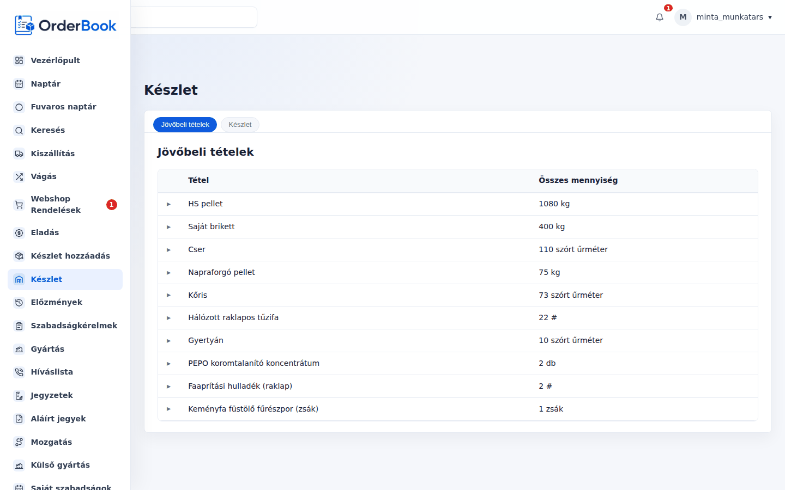
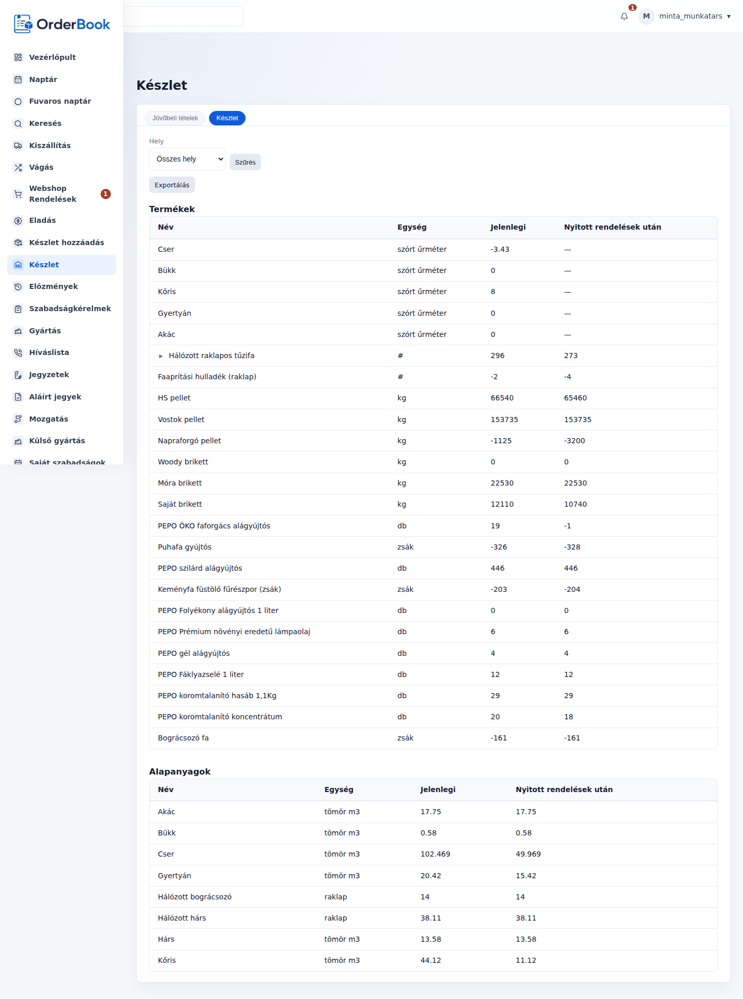
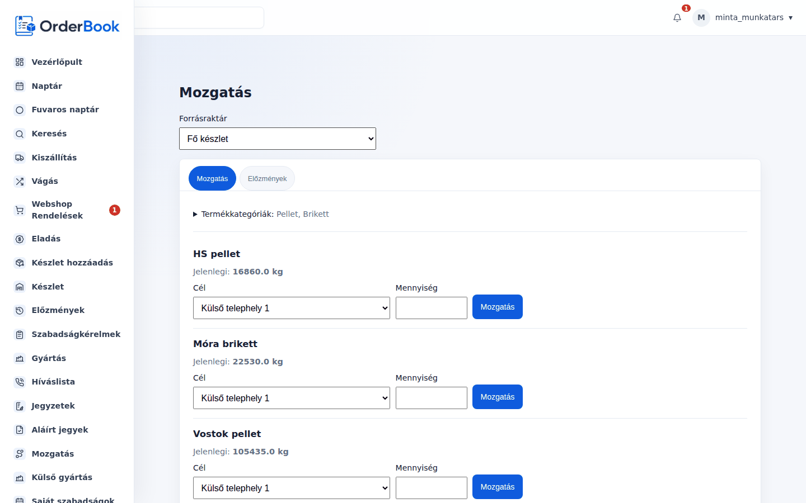
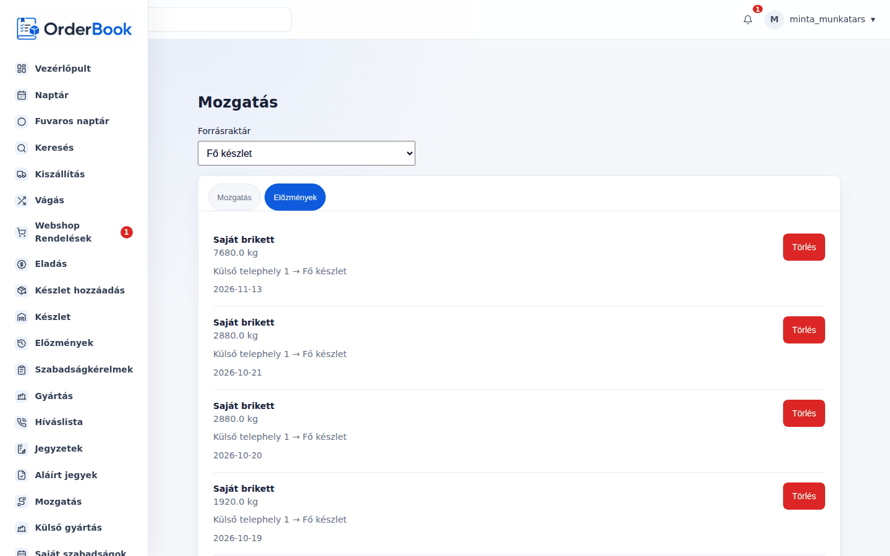

# Készlet

## Hogyan működik a készlet

A készlet egy **főkönyv**: minden változás egy-egy mozgás (sor), és a jelenlegi készlet ezek összege
(az utolsó leltár/nyitó érték óta). Kétféle készlet van:

- **Termékek** – amit eladunk (tűzifa, pellet, brikett stb.), változatonként.
- **Alapanyagok** – amiből a termék készül (pl. rönk). A vágás és a gyártás vonja le.

Mi növeli és mi csökkenti a készletet:

| Esemény | Termék | Alapanyag |
|---------|--------|-----------|
| Beszerzés rögzítése (**Készlet hozzáadás**) | + | + |
| **Készre jelölés** (Vágás oldal), tűzifánál | + (kész tűzifa) | − (felhasznált alapanyag) |
| **Kiszállítva** | − (kiszállított termékek) | |
| Gyártás rögzítése | + (gyártott termék vagy köztes alapanyag) | − (a „Készült ebből” alapanyag) |
| Raktári **Eladás** | − | |
| Eladás érvénytelenítése | + (visszaáll) | |
| Rendelés törlése | a rendelés minden mozgása visszavonódik | |
| Leltár (admin) | a tényleges mennyiségre állítja | |

Vagyis egy tűzifás rendelésnél a kész fa a vágáskor „belép” a készletbe, és a kiszállításkor „kilép”.
Ha egy rendelés vágás nélkül, közvetlenül lesz kiszállítva, mindkét mozgás egyszerre történik.

## Készlet oldal

Menü → **Készlet**. Két fül:

### Jövőbeli tételek

Az összes jövőbeli, még ki nem szállított rendelés tételei termékenként összesítve (**Tétel**, **Összes mennyiség**).
Ebből látszik, mennyit kell majd előkészíteni.

### Készlet

- **Hely** szűrő: **Összes hely**, **Fő készlet** vagy egy külső hely.
- **Termékek** táblázat: **Jelenlegi** készlet és **Nyitott rendelések után**. Több változatú termék sora a nyíllal
  (**Variációk kibontása**) bontható ki változatokra.
- **Alapanyagok** táblázat: ugyanez alapanyagokra.

Hogyan számol a **Nyitott rendelések után**:
- Nem tűzifa termékeknél: jelenlegi − a még ki nem szállított rendelések mennyisége (minden nyitott állapotban).
- Alapanyagnál: jelenlegi − azoknak a rendeléseknek az alapanyagigénye, amelyek még nincsenek készre jelölve.
- Tűzifa termékeknél nem számol (—), mert a tűzifa a vágáskor keletkezik.
- Külső helyre szűrve nem számol (—), mert a rendelések a Fő készletből fogynak.

**Export** gomb: az összes készletmozgás letöltése CSV vagy Excel formátumban (dátum, hely, tétel, változat, mennyiség,
típus, forrás: kiszállítás / beszerzés / vágás / gyártás / eladás / kézi, hivatkozás).

## Raktárhelyek

- **Fő készlet** – az alapértelmezett, saját raktár.
- **Külső helyek** – az admin veszi fel (pl. külső telephely). Archivált hely is látszik, ha van rajta készlet vagy előzmény.
- A rendelések, a normál **Gyártás**, a raktári **Eladás** mindig a **Fő készletet** használják.
- Beszerzésnél kiválasztható a hely, a **Külső gyártás** a választott külső helyre ír.

## Mozgatás helyek között

Menü → **Mozgatás** (jogosultság: **Külső gyártás - mozgatás**). Fülek: **Mozgatás** és **Előzmények**.

1. **Forrásraktár** – honnan (alapból **Fő készlet**). Csak a pozitív készletű tételek jelennek meg.
2. Tétel kiválasztása, **Cél** hely, mennyiség (szorzás is írható, pl. `4*960`), megjegyzés (max. ~300 karakter).
3. Mozgatás. A rendszer a forrásból levonja, a célhoz hozzáadja, egy lépésben.

Szabályok:
- Többet nem lehet mozgatni, mint ami a forráson van.
- Ha egy helyen az adott tételre **mai vagy későbbi leltár** van, oda/onnan nem lehet mozgatni (a leltár felülírná).
- A **Termékkategóriák** szűrővel szűkíthető a tétellista; a **Mentés minden felhasználónak** mindenkinek beállítja.
- A saját, aznapi mozgatás törölhető (ha az érintett helyek aktívak). Régebbit vagy másét csak
  **Külső gyártás - előzmények törlése** joggal lehet.
- Ha a mozgatás válasza bizonytalan (megszakadt kapcsolat), az oldal újratölt és zárolja a gombokat, hogy ne legyen dupla mozgatás.
  Ellenőrizd az **Előzmények** fülön, hogy megtörtént-e.
