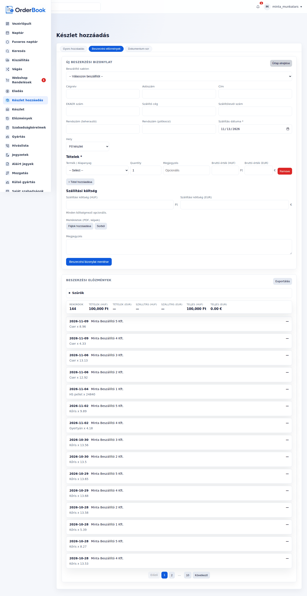
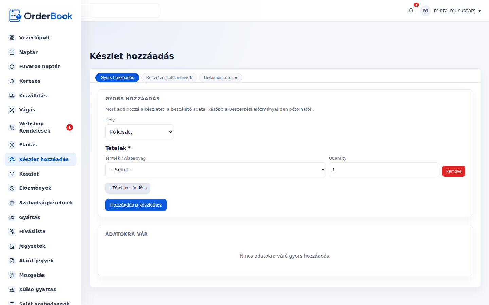
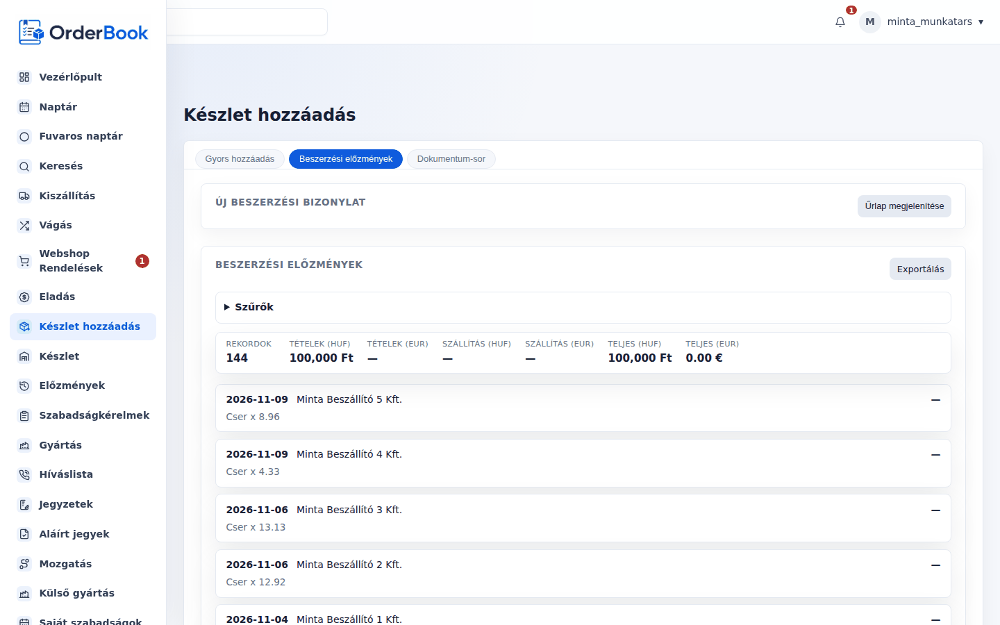
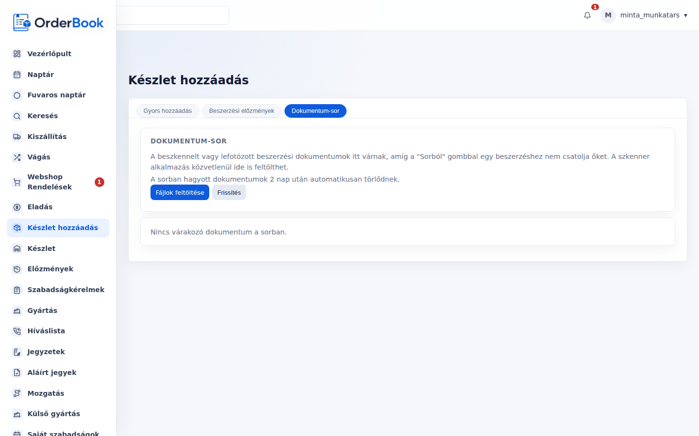

# Készlet hozzáadás (beszerzések)

Menü → **Készlet hozzáadás**. Itt rögzítjük a beérkező árut (termékek és alapanyagok) a beszállítóval, a költségekkel és a
csatolt számlával/szállítólevéllel. Minden rögzített tétel automatikusan **hozzáadódik a készlethez**.

Fülek: **Gyors hozzáadás** (ha van jogod), **Készlet hozzáadás**, **Beszerzési előzmények**, **Dokumentum-sor**.
A menüben a **Készlet hozzáadás** mellett egy figyelmeztető szám mutatja a kiegészítésre váró gyors hozzáadásokat
(**Készlet hozzáadás — szerkesztés** jog esetén).

## Teljes beszerzés rögzítése

1. **Készlet hozzáadás** fül → **Új beszerzési bizonylat** (**Űrlap megjelenítése**).
2. **Beszállító sablon** – egy mentett beszállító kiválasztása kitölti a **Cégnév**, **Adószám**, **Cím** mezőket. Kézzel is írható.
3. **Hely** – melyik raktárba érkezett (alapból **Fő készlet**). Az összes tétel ide kerül.
4. Szállítási adatok (mind opcionális): **EKAER szám**, **Szállító cég**, **Szállítólevél szám**,
   **Rendszám (teherautó)**, **Rendszám (pótkocsi)**, **Szállítás dátuma**.
5. **Tételek** → **+ Tétel hozzáadása**: termék vagy alapanyag, változat, mennyiség, költség (HUF vagy EUR).
6. **Szállítási költség (HUF / EUR)**. **Minden költségmező opcionális.**
7. **Mellékletek (PDF, képek)**: **Fájlok hozzáadása** vagy **Sorból** (a dokumentum-sorból, lásd lent).
   PDF, JPG, PNG, WEBP; a rendszer tömöríti őket.
8. **Megjegyzés**, majd **Beszerzési bizonylat mentése** → válassz: **Mentés** (az űrlap megmarad, pl. hasonló szállítmányhoz)
   vagy **Mentés és törlés** (üres űrlap).

## Gyors hozzáadás

Ha az áru megjött, de a papírok még nincsenek meg (vagy sietni kell):
1. **Gyors hozzáadás** fül → tételek, változatok, mennyiségek (max. 50 sor), **Hely**.
2. **Hozzáadás a készlethez**. A dátum mindig a mai nap.
3. A készlet azonnal nő. A beszerzés **Adatokra vár** állapotú, az előzményekben „Adatokra vár” jelöléssel látszik.
4. Később valaki (**Készlet hozzáadás — szerkesztés** jog) kiegészíti: előzmények → szerkesztés → beszállító, költség stb.
   Amint van beszállító vagy cégnév, kikerül a kiegészítendők közül.

Saját gyors hozzáadást **15 percen belül** lehet törölni (a készletmozgásokkal együtt), amíg ki nincs egészítve.

## Beszerzési előzmények

- **Szűrők**: **Ettől** / **Eddig**, **Beszállító**, **Termék / Alapanyag**, szabad szöveges keresés
  (**Helyettesítők: * = bármilyen karakterek, ? = egy karakter**). **Alkalmaz**, **Törlés**.
- **Rendezés**: dátum, cég (A–Z), költség.
- Felül összesítő sáv a szűrt rekordokra: darabszám, tételek és szállítás HUF/EUR, teljes összeg.
- Export CSV/Excel a szűrt listáról.
- Egy rekordra kattintva megnyílnak a részletek és a csatolt fájlok.

### Javítás és törlés
- **Szerkesztés** (**Készlet hozzáadás — szerkesztés** jog): bármelyik rekord bármikor javítható, a tételek is.
  A készlet a javításnak megfelelően változik. Mentés: **Módosítások mentése**.
- **Rekord törlése**: csak a szerkesztő űrlapon belül, csak a rekord **létrehozója**, és csak ha a **szállítás dátuma ma** van.
  A készlet visszaáll. Régebbi rekordnál kérd meg az admint, vagy javítsd szerkesztéssel.
- Minden létrehozás, módosítás és törlés naplózódik.

## Dokumentum-sor

**Dokumentum-sor** fül: beszkennelt vagy lefotózott beszerzési papírok (számla, szállítólevél) várólistája.
- Feltöltés: **Fájlok feltöltése** gomb, vagy a telefonos szkennelő alkalmazás automatikusan ide küldi (max. 20 MB/fájl).
- Csatolás: új beszerzésnél vagy szerkesztésnél a **Sorból** gombbal kiválasztod a dokumentumot; mentéskor átkerül a
  beszerzéshez, és kikerül a sorból.
- Ha közben valaki más már csatolta vagy elvetette, a mentés hibát ad, és semmi nem mentődik: válaszd újra a fájlokat.
- A sorban **2 napnál régebbi** dokumentumok automatikusan törlődnek.
- **Frissítés**: a lista újratöltése.
