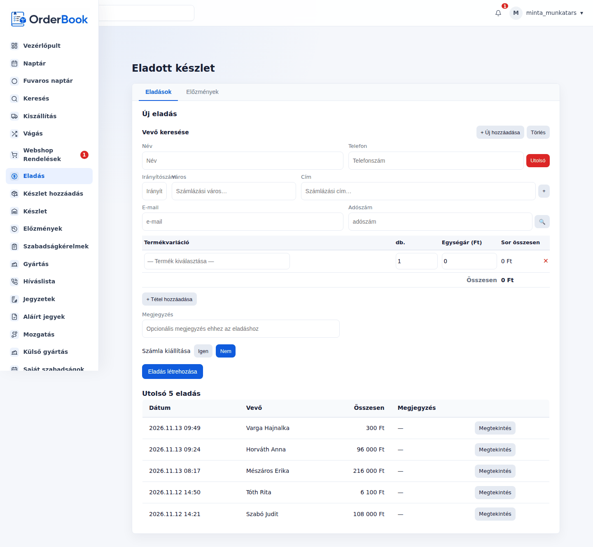
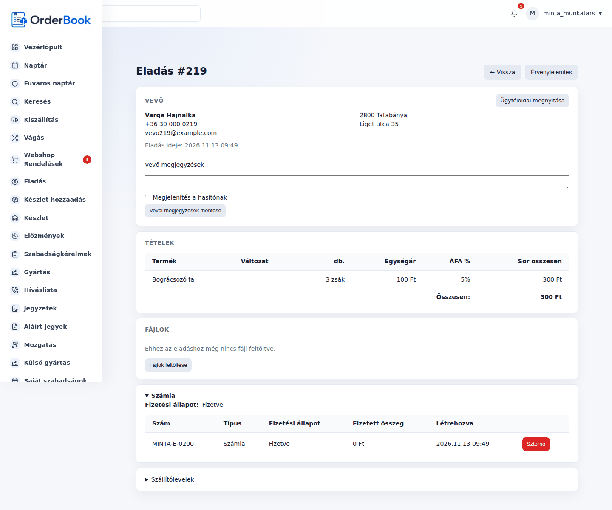
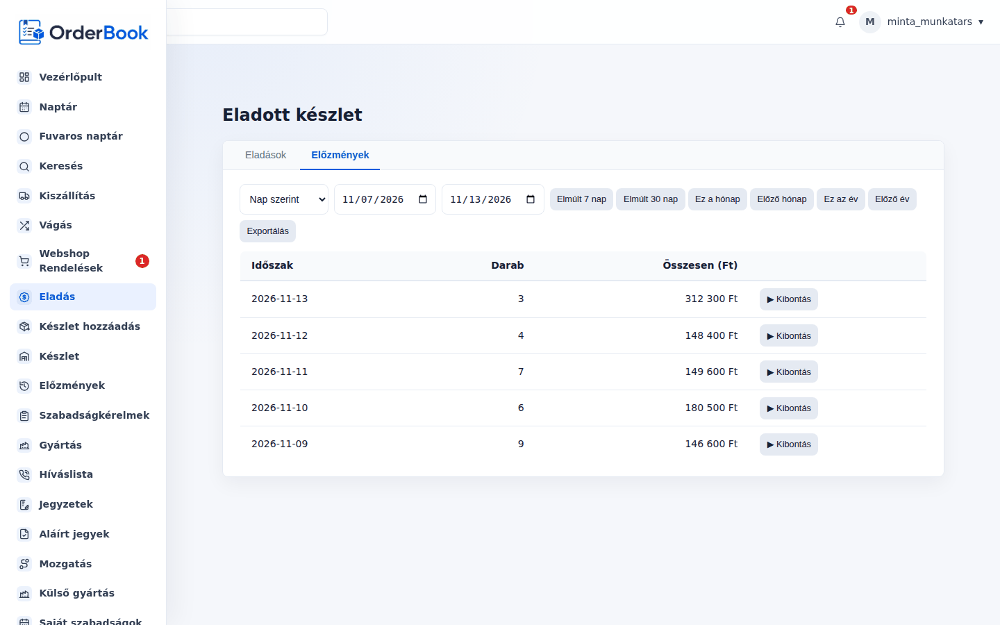

# Eladás (közvetlen raktári eladás)

Menü → **Eladás**. Akkor használd, ha az ügyfél a telepen, rendelés és kiszállítás nélkül vásárol.
Az eladás azonnal **levonja a termékeket a Fő készletből**, és opcionálisan számlát is készít.
Jogosultság: **Készlet eladás** (előzményekhez **Készlet eladás — előzmények**, előleghez **Készlet eladás - előleg rendelések**).

Fülek: **Eladások** (új eladás, utolsó 5, nyitott előleg rendelések) és **Előzmények**.

## Új eladás

1. **Vevő keresése** – ugyanúgy működik, mint a rendelésnél: név, telefon (**Utolsó** gomb), e-mail, cím, adószám
   (NAV lekérdezés), új vevő felvétele. A kiválasztott vevő paneljén a nevek, telefonok, e-mailek, adószám, megjegyzések
   és a **Problémás** jelölés szerkeszthetők. A címek módosításához **Rendelések** jog kell.
   Vevő nélkül is lehet eladni (a rendszer rákérdez), de akkor számla nem készülhet.
2. Tételek: **Termékvariáció**, mennyiség (szorzás is írható, pl. `4*960`), **Egységár (Ft)**. A **Sor összesen** élőben frissül.
   A kedvezmények itt is automatikusan számolódnak (szállítási kedvezmény nincs, mert nincs szállítás).
3. Megjegyzés: **Opcionális megjegyzés ehhez az eladáshoz**.
4. **Értékelő e-mail** – küldjön-e értékelés kérést (csak **Értékelő e-mail** joggal, e-mail címmel és ha még nem kapott).
5. **Számla kiállítása** (opcionális) – fizetési mód (**Készpénz** alapból, **Bankkártya**, **Átutalás**), dátumok (alapból ma),
   **Haladó** alatt a **Számla formátuma** (e-számla/papír) és az e-mail küldés.
6. **Eladás létrehozása**.

Ha a számlát kérted, és a Számlázz.hu hibát ad, **az eladás sem jön létre** (semmi nem mentődik), így nem lesz számla
nélküli félkész eladás. Javítsd a hibát (pl. vevő címe), és próbáld újra.

Az eladás a vevő és a tételek adatait **befagyasztva** tárolja: ha később módosul az ügyfél vagy a termék neve, ára,
a régi eladás nem változik.

## Eladás részletei

Az eladásra kattintva (pl. **Utolsó 5 eladás**) nyílik meg az **Eladás #szám** oldal:
- vevő (a befagyasztott adatok), **Eladás ideje**, megjegyzés, az ügyfél élő megjegyzései (újat is lehet írni),
  **Ügyféloldal megnyitása**,
- tételek, összesen, **Fizetési állapot** (**Fizetve**, **Részben fizetve**, **Nincs fizetve**),
- **Számla** blokk: **Számla készítése** (ha még nincs), **Előnézet**, PDF, **Sztornó**, **Nyomtatás**,
- **Szállítólevelek** blokk (ugyanúgy, mint a rendelésnél, lásd [18-szallitolevelek.md](18-szallitolevelek.md)),
- **Fájlok** – PDF-ek és képek feltöltése (**Fájlok feltöltése**),
- **Érvénytelenítés**.

## Érvénytelenítés

Ha egy eladás hibás vagy elmaradt:
1. Ha volt számla, előbb **sztornózd**. Sikeres sztornó után a rendszer felajánlja az eladás érvénytelenítését is.
2. **Érvénytelenítés** → megerősítés.

Hatása: a készlet **visszaáll**, az eladás kikerül a bevételi statisztikákból, de **látható marad** áthúzva,
**Érvénytelenítve** jelöléssel. Nem vonható vissza.

Ki érvényteleníthet:
- a saját eladását bárki a létrehozás után **15 percen belül**,
- bármelyik eladást bármikor: **Készlet eladás - bármely eladás érvénytelenítése** joggal vagy az admin.

Eladást véglegesen törölni csak az admin tud.

## Előleg rendelés (előlegszámlás eladás)

Ha a vevő előre fizet, de az árut később viszi el:
1. Új eladásnál **Haladó** → számla típus: **Előlegszámla**. Az eladás **Előleg rendelés** lesz, **Nyitott** állapotban.
   A készletet ilyenkor **még nem vonja le**.
2. A nyitott előleg rendelések az **Eladások** fülön a **Nyitott rendelések** blokkban látszanak; a menüben egy szám jelzi őket.
3. Amikor a vevő elviszi: az eladás oldalán **Befejezés** → megerősítés. Ekkor vonódik le a készlet (egyszer).
4. **Végszámla készítése** – a végszámla mindig átutalásos, és az előlegszámlára hivatkozik. Egy előleg rendeléshez csak egy
   érvényes végszámla lehet.
5. **Fizetettnek jelölés** – a fizetés kézi rögzítése (**Fizetett összeg**).

Nyitott előleg rendelést nem lehet érvényteleníteni (még nem vont le készletet); ilyenkor törölni kell
(**Készlet eladás - előleg rendelések** jog).

## Előzmények

**Előzmények** fül (**Készlet eladás — előzmények** jog): eladások **Nap szerint**, **Hét szerint**, **Hónap szerint**
csoportosítva, gyors időszakokkal (**Elmúlt 7 nap**, **Elmúlt 30 nap**, **Ez a hónap**, **Előző hónap**, **Ez az év**, **Előző év**).
Alapból az elmúlt 7 nap látszik. Egy időszakra kattintva megjelennek az egyes eladások. Export CSV/Excel formátumban.
Az érvénytelenített eladások 0 Ft-tal számítanak.
