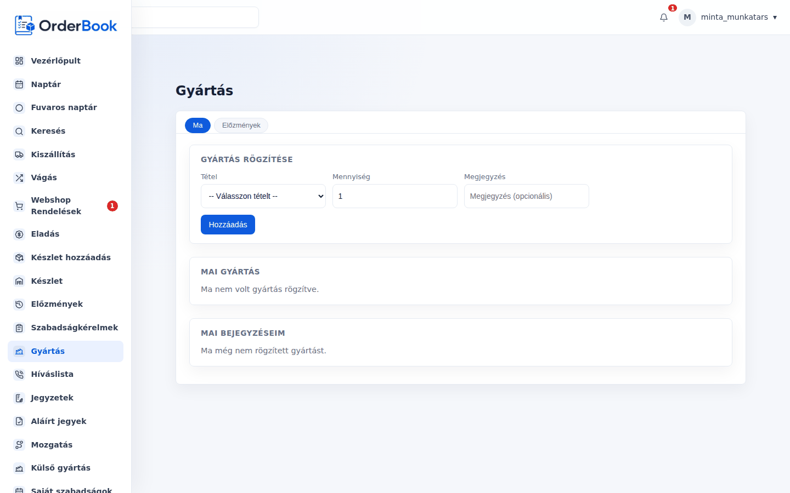
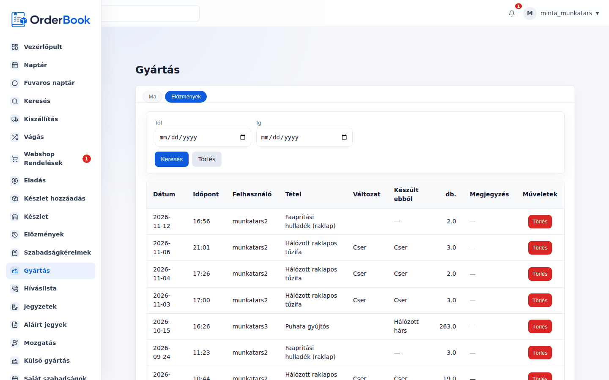
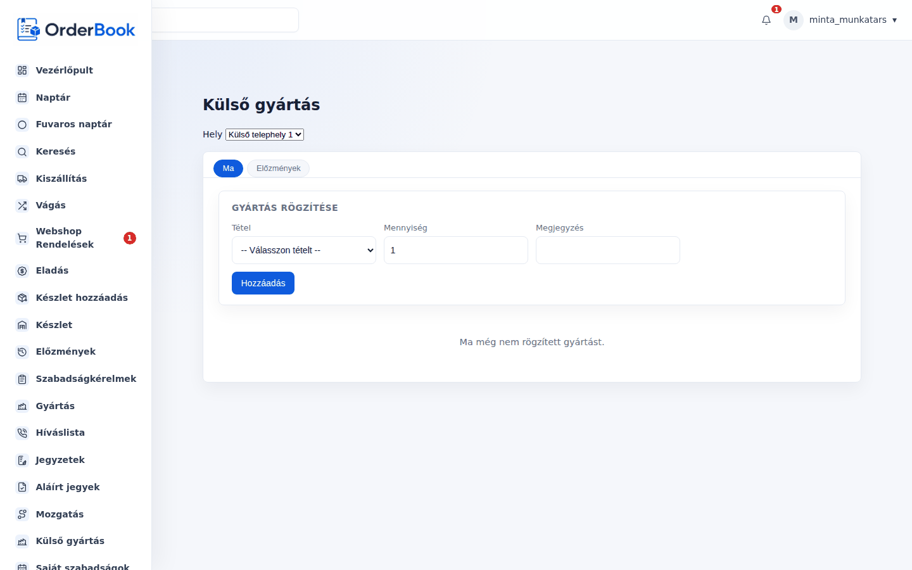

# Gyártás és külső gyártás

## Gyártás (Fő készlet)

Menü → **Gyártás**. A napi gyártás rögzítése: pl. hány zsák pellet vagy brikett készült, vagy mennyi köztes alapanyag
(pl. hasított fa) lett egy másikból. Jogosultság: **Gyártás**.

### Rögzítés

1. **Ma** fül → **Gyártás rögzítése**.
2. **Tétel** – a gyártható termékek és köztes alapanyagok egy listában.
3. **Változat** – ha a terméknek több változata van, előbb ezt kell kiválasztani.
4. **Készült ebből** – melyik alapanyagból készült. Ha csak egy lehetőség van, automatikusan kiválasztódik; ha több,
   választani kell, különben nem menthető. Csak a kiválasztott alapanyag vonódik le.
5. Mennyiség (pozitív szám) és **Megjegyzés (opcionális)**.
6. Mentés.

Mi történik: a gyártott termék vagy alapanyag **hozzáadódik** a Fő készlethez, a „Készült ebből” alapanyag
**levonódik** az átváltási arány szerint (az arányt az admin állítja be). A készletmozgás megjegyzése „Production” kezdetű.

### Mai lista
- **Mai gyártás** – mindenki mai bejegyzései és tételenkénti összesítés.
- **Mai bejegyzéseim** – a saját mai bejegyzéseid. Ezeket módosíthatod (mennyiség, megjegyzés) vagy törölheted;
  a készlet ennek megfelelően változik.

### Előzmények

**Előzmények** fül (**Gyártás — előzmények** jog): korábbi gyártások. Régi vagy más által rögzített bejegyzést törölni
csak **Gyártás — előzmények törlése** joggal lehet.

## Külső gyártás

Menü → **Külső gyártás**. Ugyanaz, mint a gyártás, de egy **külső helyen**: a gyártott termék és a levont alapanyag is a
kiválasztott külső helyen könyvelődik. Fülek: **Ma** és **Előzmények**.
- Kell hozzá legalább egy aktív külső hely (**Nincs aktív külső hely beállítva** – szólj az adminnak).
- Törlés: a saját mai bejegyzés (**Külső gyártás** jog), régebbi vagy másé **Külső gyártás - előzmények törlése** joggal.
  Archivált helyen nem lehet törölni.

A külső helyek közötti mozgatás a **Mozgatás** oldalon van (lásd [19-keszlet.md](19-keszlet.md)).
