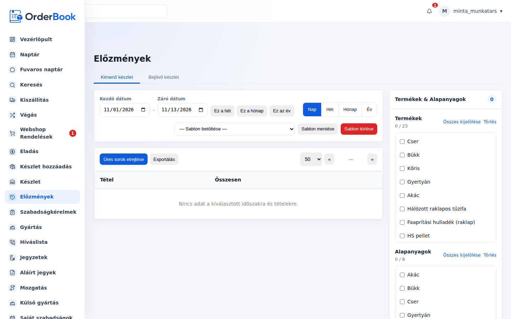
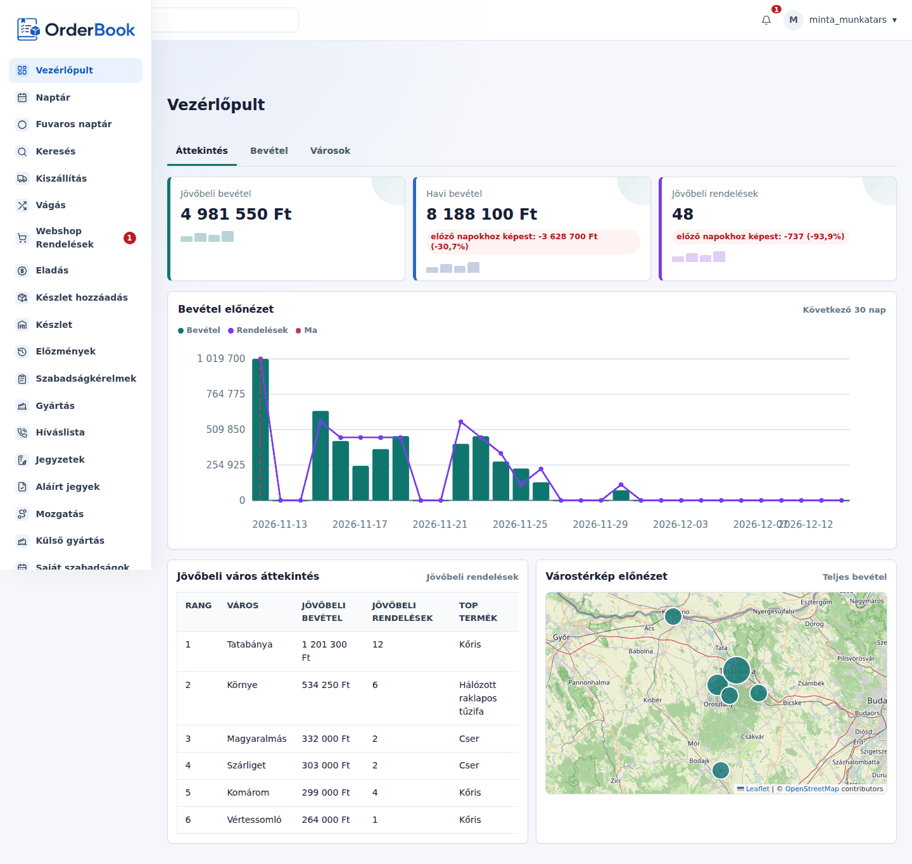

# Előzmények (készletmozgás riport) és Vezérlőpult

## Előzmények

Menü → **Előzmények** (jogosultság: **Előzmények**). Megmutatja, mennyi termék és alapanyag ment ki vagy jött be egy időszakban.

1. Fül: **Kimenő készlet** (fogyás: kiszállítás, eladás, vágásnál felhasznált alapanyag, gyártásnál felhasznált alapanyag)
   vagy **Bejövő készlet** (beszerzés, gyártás, vágásból kész tűzifa, egyéb hozzáadás).
2. **Kezdő dátum** / **Záró dátum**, vagy gyors gombok: **Ez a hét**, **Ez a hónap**, **Ez az év**.
3. **Időszak**: **Nap**, **Hét**, **Hónap**, **Év** – ilyen bontásban összesít.
4. Tételek: **Termékek** és **Alapanyagok** kiválasztása (**Összes kijelölése**, **Törlés**).
5. A táblázat tételenként és időszakonként mutatja a mennyiségeket, a végén **Összesen**. **Üres sorok elrejtése**.
6. Egy cellára kattintva **Részletek**: az egyes mozgások (**Dátum**, **Tétel**, **Mennyiség**, **Forrás**, **Hivatkozás**
   – pl. rendelésszám vagy beszerzés száma –, **Rögzítette**). A **Vissza** gomb (vagy a böngésző vissza gombja) visszavisz.
7. Export CSV/Excel formátumban.

**Sablonok**: a gyakran használt beállítás (pl. „Tűzifa havonta”) elmenthető (**Sablon mentése**, **Sablon neve**), később
betölthető (**— Sablon betöltése —**) vagy törölhető (**Sablon törlése**). A sablonok mindenkinek közösek.

A leltár sorai nem számítanak bele. A törölt rendelések mozgásai sem, mert a törléskor visszavonódnak.

## Vezérlőpult

Menü → **Vezérlőpult** (jogosultság: **Vezérlőpult**). Bevételi áttekintés, csak olvasható.

- Fő számok: jövőbeli bevétel, e havi bevétel, jövőbeli rendelések száma.
- Bevételi grafikon választható időszakra (jövő, ez a hónap, elmúlt 30 nap, ez az év, előző év, összes, egyedi),
  napi/heti/havi/éves bontásban, az előző időszakkal összehasonlítva. Hosszú időszaknál a rendszer automatikusan nagyobb
  bontásra vált.
- Bontások: városok (térképen is), termékek, termékkategóriák, szállítás/átvétel.
- A bevételbe beleszámítanak a rendelések (kedvezményekkel, szállítással) és a raktári eladások; a nyitott előleg rendelések
  és az érvénytelenített eladások nem. A törölt rendelések és a jegyzetek sem.
- „Egyéb / korrekciók” sor: szállítás, kedvezmények és párosítatlan tételek, hogy az összegek egyezzenek.
