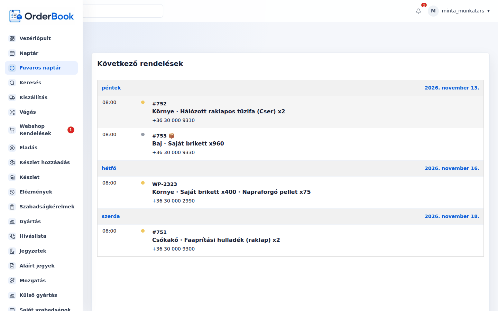

# Fuvaros naptár (külső fuvarosoknak)

A külső fuvarosok saját felhasználót kaphatnak, amely egy vagy több fuvaroshoz van kapcsolva. Ők a **Fuvaros naptár**
oldalt látják (jogosultság: **Fuvaros naptár**).

## Mit lát a fuvaros

- **Következő rendelések**: a hozzá rendelt, mai vagy későbbi rendelések listája időrendben, alapból az első 10.
  Az **Az összes további rendelés betöltése** gomb (amíg van több) az összes hátralévőt mutatja.
- Rendelésenként: rendelésszám, állapot, időpont (csak kezdés), város, tételek, telefonszám, **Megjegyzés a vágónak**.
- A rendelésre kattintva: szállítási cím (Google Maps linkkel, mentett GPS-szel, ha van), telefonszám (hívható), tételek.

## Mit nem lát

A listában nem látszik az ügyfél neve és e-mail címe. Sehol nem látja a belső rendelésmegjegyzést, a fizetési és
számlázási állapotot, a „problémás” jelölést, más fuvarosok rendeléseit, a törölt és az ütemezetlen rendeléseket.
A rendelés oldalán csak a kiszállításhoz szükséges ügyfél- és kapcsolati adatok látszanak.

## Értesítés a fuvarosnak

Amikor egy külső fuvaroshoz rendelt rendelés először **Szállításra kész** lesz (Vágás oldal: **Készre jelölés**), a rendszer
e-mailt küld a fuvaros e-mail címére (ha meg van adva). Lásd [27-emailek.md](27-emailek.md).

## Irodai teendők külső fuvarosnál

- A rendelésben válaszd ki a fuvarost a **Szállítás** blokkban. A rendelés automatikusan **Személyes átvétel** lesz
  (nincs szállítási díj, nem foglalja a saját autónk idejét).
- Szállítólevélnél a fuvarozó alapból a kiválasztott fuvaros.
- A Kiszállítás oldalon a fuvarosválasztóban válaszd ki, ha az ő rendeléseit akarod látni.
