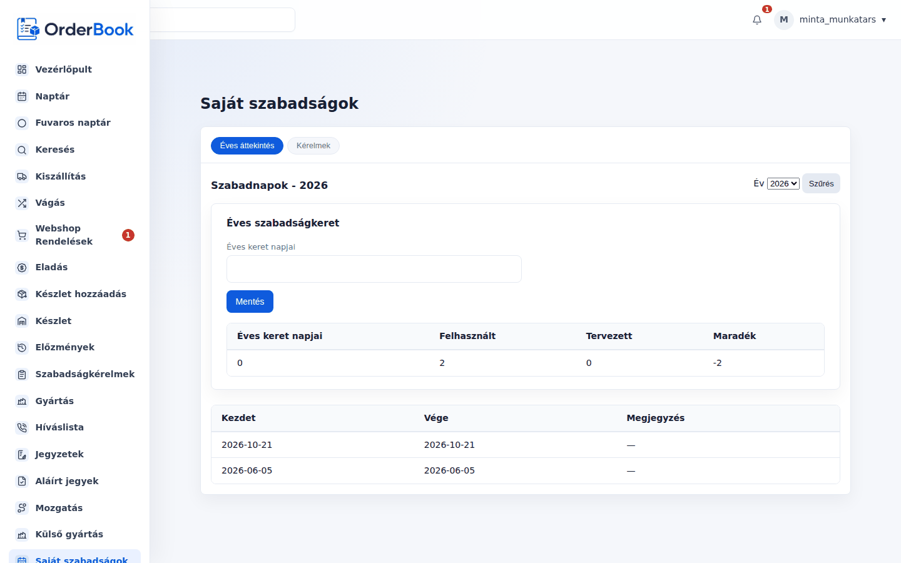
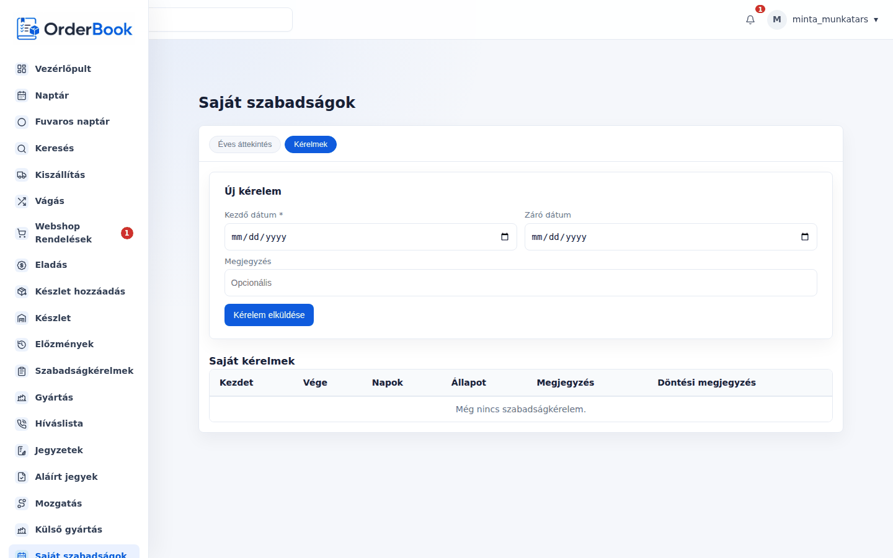
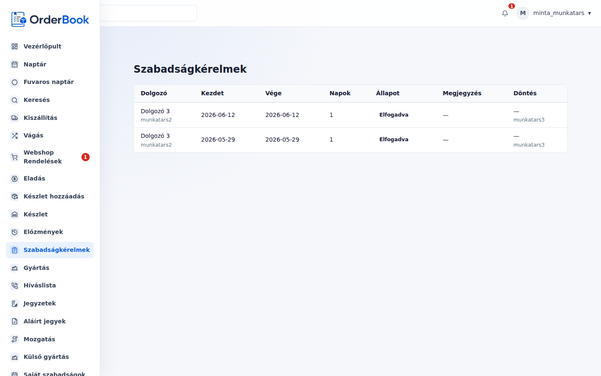

# Szabadság

## Saját szabadságok

Menü → **Saját szabadságok**. Akkor érhető el, ha a felhasználód egy dolgozóhoz van kapcsolva (ezt az admin állítja be).

### Éves áttekintés

- **Év** választó.
- **Éves szabadságkeret**: az adott évre járó napok száma. Saját magad állítod be (**Éves keret napjai**).
- **Felhasznált** (a mai napig kivett), **Tervezett** (jövőbeli jóváhagyott), **Maradék** = keret − felhasznált − tervezett.
- Csak a hétköznapok (hétfő–péntek) számítanak; a hétvége nem.
- **Szabadnapok** listája (**Kezdet**, **Vége**).

### Kérelem beadása

1. **Kérelmek** fül → **Új kérelem**.
2. **Kezdő dátum**, **Záró dátum** (egynapos szabadságnál elhagyható), megjegyzés (opcionális).
3. **Kérelem elküldése**.

- Csak hétvégét tartalmazó vagy fordított dátumú kérelem nem adható be.
- Az elbírálók e-mailt kapnak a kérelemről.
- A **Saját kérelmek** listában látszik az állapot és a **Döntési megjegyzés**. A döntésről e-mailt kapsz, ha van e-mail címed.

## Szabadságkérelmek elbírálása

Menü → **Szabadságkérelmek** (jogosultság: **Szabadságkérelmek**). A menüben egy szám jelzi a függő kérelmeket.

1. A függő kérelemnél: **Dolgozó**, dátumok, **Napok**, megjegyzés.
2. Opcionálisan **Döntési megjegyzés**.
3. **Elfogadás** vagy **Elutasítás**.

Elfogadáskor a szabadság bekerül a dolgozó szabadnapjai közé (csak a hétköznapok), és a naptárban 🏖 jelenik meg.
Csak függő kérelemről lehet dönteni. Ha az e-mail nem megy ki, a döntés akkor is mentődik.

Szabadnapot a naptárból közvetlenül is fel lehet venni (**Szabadnap hozzáadása**, lásd [10-naptar.md](10-naptar.md)).
