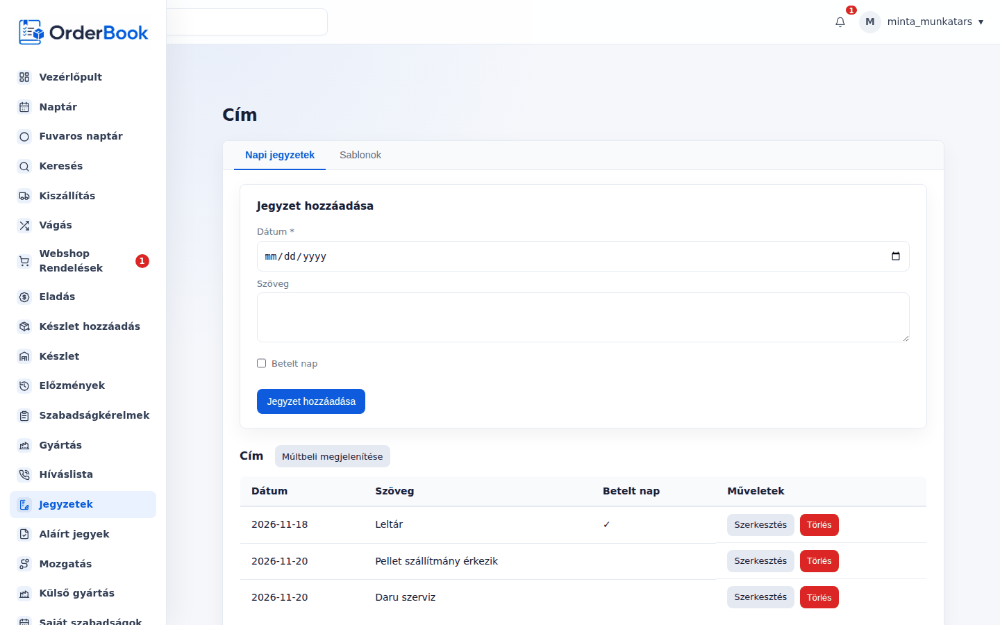
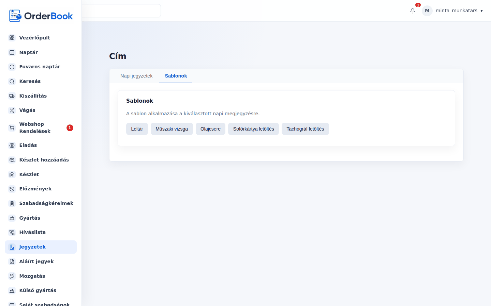

# Napi jegyzetek és sablonok

Napi jegyzet: egy naphoz tartozó szöveg, a naptár napfejlécén 📋 jellel látszik (pl. „Daru szerviz”, „Csak délelőtt szállítunk”).
Mentéséhez a **Jegyzetek (admin)** jog kell.

## Napi jegyzet felvétele

- **Naptárból**: **Nap** nézet → **Jegyzetek** → szöveg → mentés. Az oldal nem töltődik újra.
- **Jegyzetek oldalról**: menü → **Jegyzetek** → **Napi jegyzetek** fül → dátum, szöveg, és szükség esetén **Nap tele** jelölés → mentés.

Egy napra több jegyzet is lehet; minden mentés új jegyzetet hoz létre. A jegyzetek itt szerkeszthetők és törölhetők.
A múltbeli jegyzetek alapból rejtve vannak, a „múltbeliek mutatása” kapcsolóval láthatók.

## Nap tele

A **Nap tele** jelölésű nap fejléce narancssárga, és a **Első szabad időpont** kereső kihagyja ezt a napot.
A jegyzetek egyébként nem akadályozzák a rendelésfelvételt. A naptárban a **Nap tele** gombbal is megjelölhető.

## Sablonok

**Sablonok** fül: előre megírt jegyzetek egy gombnyomásra (pl. „Pellet szállítmány érkezik” 3 nap múlva).
- Egy sablon gombjára kattintva a rendszer a **mai naptól számított, a sablonban megadott számú nap múlva** létrehozza a jegyzetet.
- Ha a sablon „hétvége kihagyása” beállítású, és a cél nap hétvégére esne, a jegyzet az előtte lévő péntekre vagy az utána
  lévő hétfőre kerül.
- Sablont létrehozni és szerkeszteni az admin tud.
